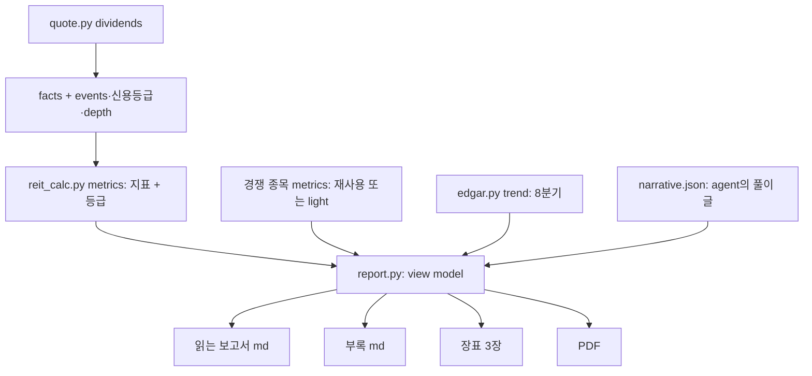

# 읽는 사람 먼저: 보고서·장표·PDF 개선

상태: 구현 중 (2026-11-19). 사용자가 맡김(2026-11-19 "추천대로 다 하고 끝까지 맡길게"): 확정, slice 동의, 결과물 확인, merge를 agent가 이중 확인으로 한다

## 문제

네 skill의 출력이 계산을 검증하는 사람을 위한 모양이다. deep 보고서는 종목당 120~250줄이고 본문에 script 칸 이름, exit 코드, status 표기가 섞여 있다. compare 결과는 지표 102개 JSON이다. 읽는 사람(전문 투자자 수준)이 "이 종목이 어떤 상태인가"를 직접 찾아야 하고, 표와 장표는 agent가 그때마다 손으로 다시 정리한다. 2026-11-19에 VICI·GLPI·NNN·DEA·MPT를 돌리며 계산 쪽 약점 일곱 가지도 드러났다(아래 결정 D8).

## 지금 구조

- deep 보고서 모양: `skills/reit-stock-review/SKILL.md`의 "보고서" 절(절 11개, 숫자는 metrics JSON에서 옮김).
- compare: `reit_calc.py compare`가 JSON을 쓰고 agent가 md를 쓴다.
- 해석 규칙: "사실로 쓰고 안전하다고 단정하지 않는다"(같은 파일 "해석할 때").
- 장표·PDF를 만드는 단계는 없다.

## 목표와 하지 않을 것

- 목표: 분석을 돌리면 한 화면짜리 읽는 보고서와 장표가 자동으로 나오고, 검증용 상세는 부록으로 분리된다. 요청하면 PDF 보고서로 발간한다. 종목 하나를 물으면 같은 subsector 경쟁 REIT 한두 개가 함께 견줘진다. 약점 일곱 가지가 고쳐진다.
- 하지 않을 것: 매수·매도 권유, 목표가, NAV/share. macro·sector·portfolio skill의 PDF(읽는 보고서와 장표까지만). 과거 분기 facts를 손으로 다시 채우는 추세.

## 제약

- 레포 규칙(`AGENTS.md`): skill은 따로 설치해도 돈다, 개인 투자 정보·secret 없음, 지어낸 값은 "(가상)".
- API key 없이 돈다.

## 끝났는지 확인하는 방법

VICI·GLPI·NNN·DEA·MPT를 새 skill로 다시 돌려: 읽는 보고서가 용어 표를 빼고 60줄 이하(처음 말한 40줄에서 경쟁 종목·추세 표가 더해져 늘림), 본문에 script 칸 이름·exit 코드 0건, 장표 자동 생성, PDF 발간, 약점 일곱 가지 재현 0.

## 용어

- **읽는 보고서**: 사람이 먼저 읽는 한 화면 보고서(`<날짜>-deep.md`). 결론, 등급, 핵심 숫자, 비교, 추세, 사건, 다시 볼 조건.
- **부록**: 계산을 검증하는 표와 출처(`<날짜>-deep-audit.md`).
- **등급**: 축마다 기준표로 매긴 넉넉·보통·빠듯·위험·판정 못 함.
- **풀이 글(narrative)**: agent가 쓰는 해석 문장. script가 검사하고 보고서에 끼운다.
- **가볍게 보기(light)**: 경쟁 종목을 핵심 칸만으로 보는 깊이.
- **단일 보고서**: 종목 하나를 물었을 때의 읽는 보고서. 그 종목이 주인공이고 경쟁 종목은 곁에 둔다.
- **비교 보고서**: 사용자가 2개 이상을 지정했을 때의 읽는 보고서. 지정한 종목이 모두 같은 무게다.

## 동작

| # | 동작 | 증명 |
| --- | --- | --- |
| B1 | deep 분석 뒤 `report.py build`를 돌리면 읽는 보고서가 나온다. 차례는 결론 한 줄, 축별 등급 표, 핵심 숫자 표, 경쟁 종목 비교 표, 8분기 추세 표, 주요 사건, 다시 볼 조건, 용어 표다. 용어 표를 빼고 60줄 이하이고, 본문에 script 칸 이름·exit 코드·영문 status가 없다 | |
| B2 | 같은 명령이 부록을 전부 만든다(FFO 재계산, AFFO bridge, 만기표, covenant 표, cap rate 다리, 데이터 구멍과 출처 위치). agent가 표를 손으로 옮기지 않는다 | |
| B3 | metrics에 축 5개의 등급과, 등급마다 근거 지표·값·기준이 들어간다. 축의 핵심 지표가 모두 없으면 "판정 못 함"이다 || S2: 다섯 종목 등급이 기준표로 손으로 매긴 값과 같음(VICI 넉넉·넉넉·위험·위험·낮은 편 등). 실데이터 갱신 뒤 GLPI 배당 여력 보통(컷 2020만) |
| B4 | 보고서는 status를 사람 말로 쓴다(공시값, 계산값, 추정, 오래됨, 없음, 공시 없음). 지표 이름은 `assets/labels.json`의 이름으로 쓰고, 처음 나오는 용어에 한 줄 풀이가 붙는다 | |
| B5 | `report.py build`가 장표 3장(등급표, 만기 일정, 배당 여력)을 만든다. diagram-slides가 없으면 장표만 건너뛰고 보고서에 한 줄 적는다 | |
| B6 | `report.py pdf`가 본문 + 차트 + 부록 + 용어 표를 A4 PDF 하나로 낸다. Chrome이 없으면 exit 1과 안내 | |
| B7 | `reit_calc.py peers T`가 같은 subsector에서 시총이 가장 가까운 2개를 고른다. `--with A,B`면 그 종목. 같은 분기 deep metrics가 있으면 재사용한다고 알린다 || S2: `peers NNN` → ADC(시총 1.06배)·EPRT(0.71배) make_light, O는 reusable_others(deep). `--with O,ADC`면 O reuse:true |
| B8 | facts에 `depth: "light"`가 있으면 핵심 칸만으로 metrics가 exit 0이고, 내지 않은 지표는 "가볍게 봄"으로 표시된다. 비교 표에 종목마다 깊이가 적힌다 || S2: NNN 핵심 칸 15개만 light → exit 0, not_assessed 44, 만기·유동성 판정 못 함. 핵심 칸이 비면 exit 2(check) |
| B9 | facts의 `events`(type, 날짜, 제목, 출처, 원문 문장, 웹이면 URL)를 script가 검사해 읽는 보고서 "주요 사건"에 최신순 5개까지 싣는다. 출처나 원문 문장이 없는 사건은 버리고 알린다 || S2: `--check` 36번. 맞는 사건 3개 최신순, URL 없는 web·모르는 type·빈 원문·날짜 아님은 버리고 data_gaps |
| B10 | 차환 금리는 회사 최근 발행 금리 > 신용등급별 > Baa(추정) 차례로 고른다. MPT 같은 투자등급 아래 회사에서 차환 비용이 음수로 나오지 않는다 || S1: MPT 발행 금리 9.25%(2026-08-10) → 차환 비용 −3,425.7 → +41,006.9천. 등급만(CCC+, 사본) → DGS10 5.10 + HY 3.43 = 8.53% |
| B11 | covenant 표나 임차인 표를 내지 않는 회사는 series 단위로 공시 없음을 적을 수 있고, exit 2로 세지 않으며 그 축은 "판정 못 함"이다 || S1: GLPI·DEA·MPT covenant `series_not_disclosed` → exit 2로 세지 않음. 실데이터 GLPI·DEA·MPT metrics exit 0 |
| B12 | 회계 기준이 달라 견줄 수 없는 Tracker subsector(Gaming)는 cap rate 차이 줄을 내지 않고 이유를 적는다 || S1: VICI·GLPI implied_cap_rate_vs_tracker 값 없음 + not_comparable + 이유(Gaming lease 회계) |
| B13 | 부채가 전부 만기 일시 상환임을 공시 위치와 함께 적으면 정기 원금 상환 0으로 fixed-charge coverage가 나온다 || S1: fixed-charge coverage VICI 4.09, NNN 4.09(만기 일시 상환, nnn-ex99_1 L842-864), GLPI 3.75(estimated, 다음 분기 최소 상환 830) |
| B14 | 연환산 NOI가 없고 분기 NOI만 있으면 분기×4를 추정으로 쓴다 || S1: DEA implied cap rate 8.79%, economic 8.88%, 모두 estimated(분기 NOI 60,086×4) |
| B15 | `quote.py dividends T`가 split 조정된 지급 내역에서 정기·특별을 가르고 연간 정기 주당 배당을 facts에 넣는다. DEA의 배당 CAGR이 계산되고, GLPI의 컷 목록에 특별배당 때문에 생긴 해가 없다 || S3: DEA 연간 정기 배당 2021~2025 2.625·2.65·2.65·2.65·2.0125, CAGR 3y −8.76%·5y −4.99%(손계산 같음), 컷 2025만. GLPI 컷 2015·2020·2022·2024 → 2020(분기 0.70 → 0.60 실제 컷). O 월 배당 |
| B16 | ticker가 바뀐 종목(MPW → MPT)도 REITWatch history percentile이 이어진다 || S2: MPT P/FFO history percentile 18.75%(표본 48, MPW 호 45개를 이음) |
| B17 | `edgar.py trend T`가 최근 8분기의 매출, 이자비용, 부채, 주식 수, 주당 배당 표를 쓰고, 읽는 보고서와 PDF에 실린다 || S3: O 8분기 trend, 2026Q3 매출 1,621,582·이자 333,564가 10-Q L287-299와 같음, 2025Q4 매출은 연간 − 9개월. MPT는 companyfacts가 2026Q1에서 끝남 |
| B18 | compare가 사람이 읽는 비교 보고서(등급표, 핵심 지표 표, subsector 경고)와 장표를 낸다. JSON은 그대로 나온다 | |
| B19 | earnings mode 보고서도 읽는 보고서 모양이다. 나빠진 등급·지표가 먼저 나온다 | |
| B20 | 풀이 글에 금지어(매수, 매도, 목표가, 사라, 팔아라, NAV/share)가 있거나 길이를 넘으면 `report.py build`가 exit 2로 멈춘다 | |
| B21 | 자잘한 표시 결함이 없다: 24개월 만기 note의 해 중복, AFFO가 공시 없음일 때 stderr의 "FAIL", 가격 지표의 기준일, 임차인 비중의 기준(ABR·매출) 표기 || S1: VICI 만기 note "2027·2028년", MPT stderr "공시 없음 affo_bridge", 가격 지표 as_of 2026-11-17, 임차인 formula에 측정 기준 |
| B22 | 기존 facts 11개(O, PLD, REXR, EGP, VICI, JNJ, GLPI, NNN, DEA, MPT 2026Q3와 O 2026Q2)로 metrics를 다시 내면 B10~B16과 새 절(등급, 사건) 말고는 값이 그대로다 || S1·S2: facts 11개 기준 코드로 두 번 구워 바이트 같음. 바꾼 뒤 exit 다름 1(NNN 2→0), 차이 381줄 모두 B 번호로 설명(`reader-first-reports-tests/regress/explain-s2.json`) |
| B23 | macro-check가 읽는 보고서(결론 한 줄, 지표 묶음별 방향 표, 풀이, 용어)와 장표를 낸다 | |
| B24 | reit-sector-scan이 읽는 보고서(섹터 위치 표, "싸 보이는 이유", 용어)와 장표를 낸다 | |
| B25 | dividend-portfolio-check가 읽는 보고서(비중, 쏠림, 월별 배당, 종목별 등급)와 장표를 낸다 | |
| B26 | 네 SKILL.md와 README가 새 차례(단일·비교를 가르는 기준 포함)를 설명하고, description은 1024자 이하다 | |
| B27 | skill 폴더만 떼어도 `--check`가 exit 0이다 | |
| B28 | 종목 하나를 물으면 보고서는 그 종목이 주인공이다. "동종 대비 위치" 절이 경쟁 종목 2개(깊이 표시)와 subsector median을 곁에 두고, 지표마다 그 종목의 순위(3개 중 몇째)를 적는다. 경쟁 종목에는 등급을 매기지 않고 숫자만 둔다(light는 등급을 매길 근거가 모자라다) | |
| B29 | 사용자가 2개 이상을 직접 지정하면 비교 보고서를 쓴다. 지정한 종목은 모두 deep으로 본다(같은 분기 deep이 있으면 재사용). 경쟁 종목을 따로 더 고르지 않는다 | |
| B30 | 비교 보고서 차례: 차이 한 줄 결론, 등급 matrix(종목 × 축), 종목마다 강점 하나·약점 하나, 축마다 차이를 만든 원인(lease 구조, 임차인, 부채 구조 등 근거 지표와 함께), 금리 민감도 견줌(차환 영향, 변동금리 충격), 주요 사건 모음, 종목별 읽는 보고서 링크, 용어 표. 어느 종목을 고르라는 말은 쓰지 않는다 | |
| B31 | 지정한 종목이 2개면 맞대기 모양(두 종목 column과 "차이" column, 차이가 큰 지표가 위로)이다. 3~6개면 matrix에 축마다 순위를 붙인다. 7개 이상이면 exit 2와 "reit-sector-scan screening으로" 안내 | |
| B32 | 지정한 종목의 subsector가 섞이면 valuation 축은 종목끼리 견주지 않고 각자 자기 subsector 기준(peer median, Tracker)과의 거리로 견주며, 보고서 첫 줄에 섞였다고 쓴다. 나머지 네 축은 그대로 견준다 | |
| B33 | 비교 보고서 장표 3장: 등급 matrix, 배당수익률 × net debt/EBITDAre 2x2, 최대 임차인 비중 막대. 2개 맞대기면 2x2 대신 핵심 지표 맞대기 막대 | |
| B34 | 비교 PDF: 비교 본문 + 종목마다 한 쪽 요약(등급, 핵심 숫자, 사건) + 부록(종목별 FFO 재계산·만기표·covenant, 출처, 용어 표) | |

## 설계

숫자는 지금처럼 facts → `reit_calc.py metrics`로 간다. metrics에 등급(scorecard)과 검사된 사건이 더해진다. 그 뒤 새 `report.py`가 metrics·facts·경쟁 종목 metrics·추세·풀이 글을 읽어 view model 하나를 만들고, 거기서 읽는 보고서, 부록, 장표, PDF를 모두 낸다.

## test할 seam

- `reit_calc.py metrics`·`peers`·`compare`의 JSON 출력: 등급, light, 공시 없음, 차환 금리를 잡는다. 글 모양은 놓친다.
- `report.py build`·`pdf`의 산출 파일: 줄 수, 금지어, 칸 이름 누출, 장표·PDF 생성을 잡는다. 글의 질은 놓친다(실데이터 다섯 종목을 직접 읽어 본다).
- `quote.py dividends`, `edgar.py trend`의 JSON 출력.

## 회귀 기준

- 대상: `~/invest-data/tickers/*/facts/*.json` 11개의 `reit_calc.py metrics` 출력
- 기준: main 290dc62 뒤 861c087의 코드, 두 번 구워 같음을 확인
- 굽기·견주기: `docs/specs/reader-first-reports-tests/regress/bake.sh`, `compare.sh`
- 뺀 것: `generated_at` 같은 시각 칸

## slice

| # | 만드는 것 | 채우는 동작 | 먼저 끝나야 하는 slice | 증명 방법 | 상태 |
| --- | --- | --- | --- | --- | --- |
| S1 | 회귀 기준을 굽고 계산 약점을 고친다 | B10~B14, B21, B22 | 없음 | 다섯 종목 facts로 MPT 차환 비용 부호, GLPI·DEA exit, VICI·GLPI Tracker 줄, DEA cap rate를 본다 | 끝: PR #17, 회귀 381줄 모두 설명 |
| S2 | 등급, 사건 검사, light, peers 고르기, ticker 별칭 | B3, B7, B8, B9, B16 | S1 | 다섯 종목 등급을 손으로 매긴 것과 견주고, NNN의 peers가 O를 재사용하는지 본다 | 끝: PR #17, 등급 손계산 일치 |
| S3 | 배당 지급 내역과 8분기 추세 | B15, B17 | 없음 | DEA CAGR, GLPI 컷 목록, O 추세 표를 공시와 견준다 | 끝: PR #16, DEA CAGR·GLPI 컷·O trend 공시 일치 |
| S4 | report.py: 단일 읽는 보고서, 부록, 장표, 풀이 글 검사, earnings 보고서 | B1, B2, B4, B5, B19, B20, B28 | S2, S3 | NNN을 끝까지 돌려 파일을 직접 읽는다 | 대기 |
| S4b | report.py compare: 비교 보고서(맞대기·matrix), subsector 섞임, 장표, 7개 이상 거절 | B18, B29, B30, B31, B32, B33 | S4 | VICI·GLPI(같은 subsector 2개)와 VICI·GLPI·NNN·DEA·MPT(섞인 5개)를 돌려 파일을 직접 읽는다. `--check`에 1·2·4·7개 fixture | 대기 |
| S5 | PDF(단일·비교) | B6, B34 | S4b | NNN 단일 PDF와 VICI·GLPI 비교 PDF를 열어 쪽마다 본다 | 대기 |
| S6 | reit-stock-review SKILL.md·README, 다섯 종목 다시 돌리기 | B26, B27 | S5 | 끝났는지 확인하는 방법 그대로 | 대기 |
| S7 | macro-check 읽는 보고서와 장표 | B23, B27 | S4 | 오늘 snapshot으로 보고서를 읽는다 | 대기 |
| S8 | reit-sector-scan 읽는 보고서와 장표 | B24, B27 | S4 | 오늘 섹터 표로 보고서를 읽는다 | 대기 |
| S9 | dividend-portfolio-check 읽는 보고서와 장표 | B25, B27 | S4 | 가상 holdings로 보고서를 읽는다 | 대기 |

## 피드백 루프

사용자 요청(2026-11-19): 보고서를 만든 뒤 검토해 약점을 찾고 고치는 일을 세 번 돈다. 기준은 **보기 좋게, 좋은 정보, 정확한 정보**, 그 외 놓치기 쉬운 것.

- 대상: VICI·GLPI·NNN·DEA·MPT 단일 보고서, VICI·GLPI 맞대기, 다섯 종목 비교의 md·장표·PDF
- 루프마다 작성 과정을 보지 않은 새 검토자 둘: 전문 REIT 투자자 눈(빠진 정보, 해석, 읽기, 결론까지 걸리는 시간)과 숫자 대조(표본을 공시 원문과 대조, 출처 없는 값, 본문·장표·PDF 일치, 기준이 다른 값끼리 견줌). 앞 루프의 지적은 알려 주지 않는다
- 검토 기준: 보기 좋게(첫 화면 결론, 표가 한 화면, 장표를 폭 760px로 줄여도 읽힘, PDF 쪽 나눔, 자릿수·단위 일관), 좋은 정보(왜·동종 대비·무엇이 바뀌면 달라지나에 답, 해석 없는 나열 없음, 중요한 사건 빠짐 없음), 정확한 정보(원문 대조, 추정 표시, 같은 숫자 일치, 기준 다른 값 견줌 없음), 그 외(용어 풀이, 권유·목표가 없음, 데이터 없음을 괜찮음으로 오해하게 쓰지 않음, 중복 없음)
- 지적마다 등급(꼭 고침 / 고치면 좋음), 파일 위치, 고치는 법. 메인이 실제 파일에서 다시 확인해 맞는 것만 고친다
- merge 조건: 세 번째 루프의 "꼭 고침" 0건

## 결정

| # | 결정 | 답 | 정한 쪽 | 먼저 정할 것 | 이유와 버린 대안 | 상태 |
| --- | --- | --- | --- | --- | --- | --- |
| D1 | 해석을 어디까지 | 축마다 기준표로 등급(넉넉·보통·빠듯·위험·판정 못 함)을 script가 매기고 근거 지표를 같이 낸다. valuation 축은 좋고 나쁨이 아니라 위치(낮은 편·중간·높은 편). 권유·목표가는 계속 금지 | 추천대로 | 없음 | 등급이 있어야 한눈에 읽히고, 기준표라 왜 그 등급인지 되짚을 수 있다. 버린 대안: 사실만(지금), 종합 의견(모델 주관) | 정해짐 |
| D2 | 장표를 언제 | 분석할 때마다 자동(종목 3장, 비교 3장). diagram-slides가 없으면 장표만 건너뜀 | 사용자 | 없음 | "장표로 구워 주는 것도 좋다" | 정해짐 |
| D3 | 숫자 밖 정보 | 공시(10-Q·8-K 본문의 임차인 신용 사건, 소송, 결산 후 사건, guidance 변화) + 웹 네 가지(신용등급, 임차인 신용 사건, 배당 발표, guidance 변경). 항목마다 출처와 원문 문장, 웹이면 URL | 추천대로 | 없음 | 2026-11-19 실행에서 가장 중요한 정보 둘(Bally's going concern, MPT 임대료 미수)이 지표가 아니라 본문 문장이었다 | 정해짐 |
| D4 | 읽는 사람 수준 | 전문 투자자 수준. 용어 풀이는 항상 넣는다(처음 나올 때 한 줄 + 끝에 용어 표) | 사용자 | 없음 | 사용자 답 | 정해짐 |
| D5 | PDF 발간 | "PDF로", "레포트 발간해줘"라고 하면 본문 + 부록(FFO 재계산, AFFO bridge, covenant, 만기표, 출처, 용어 표)을 A4 밝은 배경 PDF 하나로 낸다 | 사용자 + 추천대로 | D2 | 전문 투자자가 읽는 보고서는 숫자의 출처를 그 자리에서 확인할 수 있어야 한다. 버린 대안: 본문만 | 정해짐 |
| D6 | 경쟁 REIT 함께 보기 | 종목 하나를 물으면 같은 subsector에서 시총이 가장 가까운 2개를 함께 본다(사용자가 지정하면 그것). 같은 분기 deep metrics가 있으면 재사용, 없으면 가볍게(보도자료 핵심 숫자 + XBRL + REITWatch). "경쟁사도 깊게"라고 하면 모두 deep | 사용자 + 추천대로 | 없음 | deep 하나가 약 20만 토큰이라 늘 3배를 쓰지 않는다. 쓸수록 재사용이 늘어 비교가 깊어진다 | 정해짐 |
| D7 | 추세 | SEC XBRL로 8분기 추세(배당, 부채, 이자비용, 매출, 주식 수)를 자동으로, 직전 분기 metrics가 있으면 diff | agent | 없음 | XBRL은 이미 받는 파일이라 비용이 거의 없다. 버린 대안: 과거 4분기 facts를 모두 손으로 채우기(종목당 비용 5배) | 정해짐 |
| D8 | 약점 일곱 가지 | 모두 범위에 넣음: covenant 표 없는 회사의 not_disclosed, 기준이 다른 Tracker subsector 경고, bullet 부채 회사의 fixed-charge coverage, 등급별 차환 금리, split·특별배당이 든 배당 이력, 분기 NOI 연환산, ticker 변경 별칭 | agent | 없음 | 2026-11-19 다섯 종목 실행에서 재현 | 정해짐 |
| D9 | 적용 차례 | reit-stock-review 먼저, 나머지 세 skill은 같은 형식을 뒤따라 | agent | 없음 | 가장 자주 쓰고 약점이 여기서 나왔다 | 정해짐 |
| D10 | 만드는 쪽 | 보고서(읽는 보고서 md, 부록 md, 장표 HTML, PDF)는 script(`report.py`)가 metrics·facts에서 만든다. agent는 풀이 글만 `narrative.json`(결론 한 줄, 축별 풀이, 위험 3개, 다시 볼 조건, 장표 제목)으로 쓰고 script가 검사한다(금지어, 길이) | agent | D1, D2, D5 | agent가 표를 손으로 옮기면 종목마다 토큰을 쓰고 모양이 달라진다. 한 view model에서 md·장표·PDF가 같이 나오면 숫자가 서로 어긋나지 않는다. 버린 대안: agent가 md 전체를 씀(지금) | 정해짐 |
| D11 | 등급 기준 | `assets/scorecard.json`. 축 5개: 배당 여력(AFFO payout, 없으면 FFO payout을 한 단계 보수적으로, 최근 3년 컷이 있으면 한 단계 내림), 부채(net debt/EBITDAre와 interest coverage 중 나쁜 쪽, covenant 최소 여유가 15% 미만이면 한 단계 내림), 만기·유동성(최대 만기 해 비중, 24개월 liquidity coverage, 차환 영향/AFFO 중 가장 나쁜 것), 임차인 집중(top1, top10. WALE·occupancy는 곁에 보임), valuation 위치(자기 history percentile, peer median 대비). 축의 핵심 지표가 모두 공시 없음·없음이면 판정 못 함 | agent | D1 | 기존 flag 기준(`thresholds.json`)을 4단계로 넓힌 경험칙이다. 가장 약한 고리로 매겨 숨은 위험이 평균에 묻히지 않게 한다 | 정해짐 |
| D12 | 차환 금리 | 회사의 최근 12개월 안 발행 금리(공시값) > 신용등급별(투자등급: Baa yield, 그 아래: DGS10 + HY OAS, BB면 BB OAS) > 등급을 모르면 Baa(추정이라고 표기). 시장 금리가 지금 가중평균 금리보다 낮게 나오면 그 사실을 적는다 | agent | D8 | MPT(투자등급 아래)가 Baa로는 차환 비용이 줄어드는 것처럼 나왔다. 실제 8월 발행은 9.25%였다. HY OAS는 FRED에 key 없이 있다(BAMLH0A0HYM2, BAMLH0A1HYBB 2026-11-17 2.04) | 정해짐 |
| D13 | 배당 이력 출처 | key 없는 Yahoo chart `events=div,split`(split 조정된 지급 내역)에서 정기·특별을 가르고 연간 정기 주당 배당과 컷을 낸다. XBRL 연간 값은 대조용 | agent | D8 | XBRL 연간 합은 reverse split(DEA 2025)과 특별배당(GLPI)을 컷으로 읽었다. 2026-11-19 확인: DEA 응답에 split 1건(4:10)과 조정된 분기 배당 41건이 있다 | 정해짐 |
| D14 | 장표 도구 | 장표 HTML은 `diagram-slides` skill 형식으로 script가 쓰고, 그 skill의 `render_slide.py`가 있으면(`DIAGRAM_SLIDES_DIR` 환경 변수, 없으면 skills 폴더의 `diagram-slides`) PNG로 굽는다. 없으면 건너뛰고 보고서에 한 줄 적는다. PDF의 차트는 장표와 따로 script가 밝은 배경 SVG로 그린다 | agent | D2, D5 | skill은 따로 설치해도 돌아야 한다. 어두운 장표 PNG를 흰 PDF에 넣으면 인쇄에 맞지 않는다 | 정해짐 |
| D15 | 가볍게 보기 | facts에 `depth: "light"`를 적으면 핵심 칸(FFO·AFFO, 배당, 주식 수, net debt·EBITDAre, 이자비용, 최대 임차인, occupancy 등 15개 안팎)만으로 metrics가 exit 0으로 끝나고, 내지 않은 지표는 "가볍게 봄"으로 표시한다 | agent | D6 | 같은 script와 같은 식을 쓰면 deep으로 올릴 때 facts만 더 채우면 된다 | 정해짐 |
| D16 | 토론 생략 | 이 설계는 Fable과 따로 토론하지 않았다 | agent | 없음 | 이번 대화의 메인 모델이 Fable이라 같은 모델끼리의 토론은 답을 바꾸지 않는다. 대신 검증 단계에서 새 subagent 셋이 본다 | 정해짐 |
| D17 | 단일과 비교를 가르는 기준 | 사용자가 종목 이름을 2개 이상 말하면 비교, 하나면 단일. "O랑 비슷한 거", "O 경쟁사랑"처럼 하나만 말하고 견줄 상대를 맡기면 단일(경쟁 종목 자동). "O, ADC 비교"는 비교 | 사용자 + agent | D6 | 사용자 요청(2026-11-19): 한 종목을 물을 때와 직접 지정할 때 보고서가 달라야 한다. 질문이 다르다: 단일은 "이 종목이 어떤 상태이고 동종 안에서 어디쯤인가", 비교는 "이 종목들이 어디서 갈리고 왜 갈리나" | 정해짐 |
| D18 | 비교에서 지정한 종목의 깊이 | 모두 deep(재사용 우선) | agent | D17 | 사용자가 직접 고른 종목이라 같은 깊이로 봐야 등급 matrix가 공정하다. light와 deep을 한 matrix에 두면 light 쪽이 "판정 못 함"으로 가득해 비교가 안 된다 | 정해짐 |
| D19 | 비교 모양 | 2개 맞대기, 3~6개 matrix + 순위, 7개 이상 거절 | agent | D17 | 2개는 지표마다 차이를 바로 보는 것이 가장 빠르다. 7개가 넘으면 한 장표·한 표에 안 들어가고 screening의 일이다 | 정해짐 |
| D20 | subsector가 섞인 비교의 valuation | 종목끼리 견주지 않고 각자 자기 subsector 기준과의 거리(peer median 대비, Tracker 대비)로 견준다 | agent | D17 | 2026-11-19 다섯 종목 compare가 Gaming과 Office의 P/FFO를 같은 줄에 놓아 경고만 붙였다. 거리로 바꾸면 섞여도 읽힌다 | 정해짐 |
| D21 | 단일 보고서의 경쟁 종목 등급 | 매기지 않고 숫자만 | agent | D6, D15 | light는 covenant·만기표 같은 근거가 없어 등급이 "판정 못 함"투성이가 되고, 주인공과 같은 무게로 읽힌다. 경쟁 종목을 deep으로 재사용한 경우에도 단일 보고서에서는 숫자만 둔다(등급은 그 종목의 보고서에 있다) | 정해짐 |
