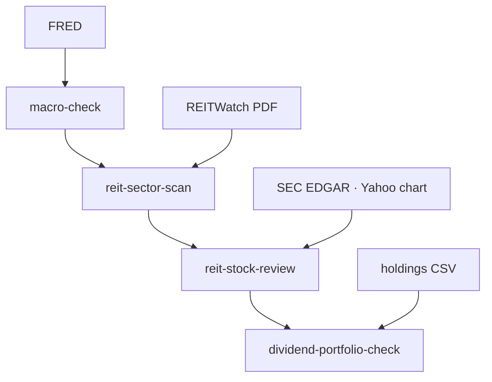

# 미국 REITs·배당주 분석 skill 묶음

상태: 검증 끝 (2026-11-18)

사용자가 맡김(2026-11-18): slice 동의, 결과 확인, PR merge까지 agent가 이중 확인으로 대신한다.

## 문제

미국 REITs에 배당 투자를 하면서 매번 매크로 지표, 섹터 valuation, 종목 공시를 손으로 찾아 맞춘다. 공개된 Agent Skill 중에는 REIT 지표(FFO, AFFO, implied cap rate, 만기 사다리, WALE)를 계산까지 해 주는 것이 없고, 매크로·섹터 저평가를 함께 보는 것도 없다. LLM에게 그냥 물으면 출처 없는 숫자가 섞이고, 같은 질문에 다른 숫자가 나온다.

## 지금 구조

- `~/invest-skills`는 빈 레포다(`skills/.gitkeep`만 있음). 규칙은 `AGENTS.md`에 있다.
  - `AGENTS.md:11`: 스크립트는 자기 skill 폴더 안의 것만 import한다. skill 하나만 설치해도 그 skill의 스크립트가 돌아야 한다.
  - `AGENTS.md:19-21`: 개인 투자 정보·secret을 레포에 두지 않는다. 매수·매도를 권하는 문장을 쓰지 않는다.
- skill은 `~/.claude/skills`, `~/.agents/skills`에 work-skills의 skill과 한 단계로 symlink된다. 이름이 겹치면 안 된다.

## 목표와 하지 않을 것

- 목표
  - 사용자가 말로 부탁하면 agent가 아래 여섯 가지를 해낸다: 매크로 점검, 저평가 섹터 찾기, 종목 하나 깊게 분석, 같은 섹터 종목 비교, 분기 실적 뒤 점검, 내 포트폴리오 점검.
  - 숫자는 script가 계산하고, 모든 값에 출처·기준일·상태가 붙는다. 같은 입력이면 같은 숫자가 나온다.
- 하지 않을 것
  - 매수·매도 추천, 목표가, 주문 계획. 결과는 판단 재료다.
  - 한국 상장 리츠(K-REITs). 지금은 미국만 다룬다. 지표 틀은 나중에 재사용할 수 있게 둔다.
  - 유료 데이터(Green Street P/NAV, CoStar, STR) 연동.
  - 실시간 시세, 자동 매매.

## 제약

- public MIT 레포. 개인 투자 정보(보유 종목, 관심 종목, 매매 기록), 받은 데이터(REITWatch는 Nareit 저작물), API key를 레포에 두지 않는다.
- Python 3 표준 라이브러리만 쓴다(이 Mac은 python3 3.9.6, requests·pandas 없음). 외부 도구는 `pdftotext` 하나다.
- API key 없이 돌고 미리 할 설정이 없다(D80, D82, D83). SEC 공시 원문을 처음 받을 때만 사용자에게 연락처를 한 번 묻는다. 시세는 key 없는 Yahoo chart, FRED는 key 없는 `fredgraph.csv`다. 둘 다 문서에 없는 endpoint라 실패하면 missing으로 두고 웹 채우기로 넘긴다.
- SEC EDGAR는 초당 10회까지다. data.sec.gov·efts.sec.gov는 식별 정보 없는 `invest-skills/1.0`으로 받는다. www.sec.gov(공시 원문)는 연락처가 든 User-Agent를 요구해서, 처음 받을 때 사용자에게 이름·이메일을 한 번 묻고 `$INVEST_DATA_DIR/config.json`에 둔다(`SEC_USER_AGENT` 환경 변수가 먼저, D83). key가 아니다.
- Claude Code와 Codex가 같은 SKILL.md를 읽는다. 특정 agent에만 있는 도구는 "있으면 쓰고, 없으면"으로 쓴다.

## 끝났는지 확인하는 방법

- skill마다 `python3 <skill>/scripts/<이름>.py --check`가 network 없이 fixture로 돌아 exit 0이다.
- 실제 데이터로 한 번씩 돈다: `macro-check`가 FRED snapshot을 만들고, `reit-sector-scan`이 최신 REITWatch로 섹터 표를 만들고, `reit-stock-review`가 O(Realty Income) 2026Q3 FFO를 회사 발표값 1,041,026천 달러와 맞추고, `dividend-portfolio-check`가 가상 holdings 파일로 보고서를 낸다.
- diff에 개인 투자 정보·secret·받은 데이터 파일이 없다.

## 용어

- **snapshot**: 한 시점의 값을 담은 JSON 파일. 날짜·분기 이름으로 쌓고 덮어쓰지 않는다.
- **데이터 폴더**: `$INVEST_DATA_DIR`(기본 `~/invest-data`). 레포 밖에서 snapshot·보고서·holdings를 담는다.
- **status**: 값마다 붙는 상태. `reported`, `derived`, `estimated`, `stale`, `missing` 다섯 가지.
- **flag**: 지표 판정. `ok`, `watch`, `alert`, `review`. `review`는 데이터가 없어 판단 못 함이다.
- **REITWatch**: Nareit이 매달 내는 PDF. subsector와 종목별 가격, consensus FFO, P/FFO, 배당수익률이 있다.
- **웹 채우기**: script로 못 받는 값을 agent가 웹 검색으로 찾아 출처와 함께 적는 일.

## 동작

| # | 동작 | 증명 |
| --- | --- | --- |
| B1 | "금리·고용 요즘 어때", "매크로 점검해줘"라고 하면 `macro-check`가 FRED에서 금리·credit spread·물가·고용·경기·주택·건설 지표를 받아 snapshot과 보고서를 쓴다. 지표마다 최신값, 1·3·12개월 변화, YoY, 10년 percentile이 있다 | S1: `env -u FRED_API_KEY python3 skills/macro-check/scripts/macro.py fetch --sector office` exit 0, 28초, `~/invest-data/macro/snapshots/2026-11-18.json`에 FRED 31개 series가 모두 reported(stale 0). 지표마다 `derived`에 chg_1m·3m·12m, yoy_pct, pctile_10y(예: DGS10 5.12, +0.03/+0.44/+0.98, pctile 99.3195). 나머지 섹터 7개도 각각 받아 48개 series 전부 reported. snapshot으로 `~/invest-data/macro/reports/2026-11-18.md`(group 7절 + office·retail 섹터 절 + 데이터 구멍)를 썼다. `--check`가 손계산 값(USPBS YoY 1.2044, 가상 TESTM percentile 25.0, CPI 2025-10 빈 달이면 12개월 변화 null)과 맞음 |
| B2 | 섹터 이름을 주면 그 섹터의 수요·공급 지표(예: 오피스 ↔ professional and business services 고용, 오피스 건설 지출)를 함께 낸다 | S1: 같은 run의 `sectors.office` = USPBS, USINFO, USFIRE(수요), TLOFCONS(공급). 이어서 `fetch --sector retail`을 돌리자 같은 날 snapshot에 retail 6개가 더해지고 office와 웹 값이 남음(series 35개). `--check`의 "--sector office는 core + office" 통과 ; 검증 고침: 같은 날 `fetch --group rates --sector office`가 `sectors.office`를 비우던 것을 앞 목록에 합치게 했다(D66). break repro F11: 복사본 snapshot에서 같은 명령 뒤 `sectors.office` = USPBS, USINFO, USFIRE, TLOFCONS 그대로. `--check`가 좁혀 받은 목록을 합치는지 확인 |
| B3 | API key 없이 B1이 돈다(FRED는 key 없는 `fredgraph.csv`만 쓴다, D82) | S1: 위 run이 `FRED_API_KEY` 없이(`env -u`) `fred_access: fredgraph.csv`로 돌았다. DGS10 최신값 5.12(2026-11-16)가 https://fred.stlouisfed.org/series/DGS10 page의 "2026-11-16: 5.12"와 같음. custom User-Agent를 붙이면 fredgraph가 응답하지 않아 urllib 기본값을 쓴다 ; keyless: 공식 API 경로를 뺀 코드로 `env -u FINNHUB_API_KEY -u FRED_API_KEY -u SEC_USER_AGENT`, 데이터 복사본(cache를 하루 넘게 돌려 다시 받게 함)에서 `macro.py fetch` exit 0, 27개 series를 `fredgraph.csv`로 받아 FRED missing 0(missing 2는 웹 채우기 전 항목), DGS10 5.12(2026-11-16) reported. `--check`가 가짜 http_get으로 요청 URL이 `fredgraph.csv?id=DGS10`이고 `api_key`가 없음을 확인 |
| B4 | FRED에 없는 값(ISM PMI, Fed funds 기대치)은 웹 채우기로 넣고 `source: web`과 URL을 단다. 못 찾으면 `missing` | S1: ISM 1차 자료 PDF(ismworld.org r4in202610pmi.pdf)의 "The Manufacturing PMI® registered 55.5 percent."를 `macro.py web ISM_MFG_PMI --value 55.5 --as-of 2026-10 --url ... --quote ...`로 넣어 `reported`, `source: web:<URL>`, `locator`=원문. CME FedWatch page는 60초 timeout이라 `--missing`으로 missing. `--quote` 없이 넣으면 exit 1로 거절. `--check`가 `--secondary`→estimated, 오래된 기준일→stale을 확인 ; 검증 고침: `--check`가 오래된 2차 자료는 estimated를 지키고(D62), `--missing`은 앞 값을 지우지 않고 exit 2(D65), NaN·무한대 값과 오늘보다 늦은 `--as-of`는 exit 1인지 확인. break repro F10: reported 55.5가 있는 snapshot에 `web ISM_MFG_PMI --missing` → 값이 남고 exit 2 |
| B5 | "어느 섹터가 싸", "저평가 섹터 찾아줘"라고 하면 `reit-sector-scan`이 REITWatch를 받아 subsector마다 median P/FFO·배당수익률의 자기 history percentile·z-score, 배당수익률−10년물 spread, 3·5년 상대 성과를 표로 낸다 | S2: backfill 뒤 `reitwatch.py sectors --out ~/invest-data/sectors/2026-11-18.json` exit 0. REITWatch 2026-10 호(가격 기준일 2026-09-30, 종목 180개, unparsed 0)로 equity subsector 17개 표, 표본 48개 호(2015-01~2026-10의 1·4·7·10월). Free Standing: P/FFO median 12.465, 배당수익률 median 5.125. PDF text의 Free Standing 10개 row를 손으로 정렬해 센 값(P/FFO 가운데 12.45·12.48 → 12.465, 배당 5.09·5.16 → 5.125)과 같음. P/FFO percentile 4.1667·z -1.54, spread +0.005(DGS10 5.12, 2026-11-16), 3·5년 상대 +0.74·+5.19. `--macro-snapshot /nonexistent/snap.json`이면 exit 2, DGS10과 17개 subsector의 spread가 모두 `missing`(note "macro snapshot이 없음"), 구조 신호 `review`. `--check`가 손계산 값(지어낸 fixture의 median 14.0, percentile 30.0, z -0.7746, spread 0.75, 상대 +0.5)과 맞음 |
| B6 | 처음 돌 때 2015-01부터 1·4·7·10월 호(가격 기준일이 분기말, D17)와 최근 12개월을 backfill한다. 파싱한 JSON만 남기고 PDF는 지운다 | S2: `fetch --month 2026-10 --backfill` exit 0, 1분 37초. 받음 55, 이미 있음 1(2026-10), 실패 0. 2015-01~2026-10 호 56개 모두 unparsed 0, 종목 180~213개. 끝난 뒤 `~/invest-data/reitwatch`에 PDF·txt 0개, 전체 5.0M(parsed 56개 + history.csv). `fetch --month latest`는 RW2611이 404라 2026-10을 받음. `--check`가 달 목록 56개, 이미 받은 호 건너뛰기, latest의 404 건너뛰기를 확인 |
| B7 | 섹터를 고르면 그 섹터 종목의 screening 표(P/FFO, 배당수익률, 시총, debt ratio)를 낸다 | S2: `peers --ticker O` → Free Standing 10종목, P/FFO 오름차순(PINE 8.11, GTY 11.21, NNN 11.6 …), 칸 P/FFO·배당수익률·시총·debt ratio 등, median P/FFO 12.465. PINE 8.11·7.38은 PDF row와 같음. 없는 이름(`--subsector Offices`)은 exit 1과 있는 이름 목록 |
| B8 | 구조적 하락 신호(수요 지표가 계속 나빠지고, 공급이 계속 늘어남)가 있는 섹터는 "싸 보이는 이유"를 함께 적는다 | S2: macro snapshot에 섹터 7개를 더 받은 뒤(B19) `structural.flag`가 watch 5개: Office(demand 3개 중 USINFO·USFIRE 나빠짐, TLOFCONS 늘어남), Data Centers, Apartments·Manufactured Homes·Single Family Homes(임대 공실률 상승, 5+ unit 허가 증가). 메모 절차는 SKILL.md "구조적 하락 신호"에 썼다. 메모를 실제로 쓰는 것은 agent 몫이라 이번 증명에서는 판정까지만 확인했다. `--check`가 판정 규칙(나빠짐·늘어남·supply 없는 섹터는 ok·snapshot에 없는 섹터는 review)을 확인 |
| B9 | "O 분석해줘"라고 하면 `reit-stock-review` deep mode가 EDGAR에서 최신 실적 8-K Ex.99와 XBRL을 받고, agent가 값을 읽어 facts에 위치와 함께 적고, script가 지표를 계산해 보고서를 쓴다 | S3: `SEC_USER_AGENT`(일반 값, 이 실행에만 export)로 `edgar.py resolve O`(CIK 0000726728, SIC 6798 → is_reit) → `filings O`(latest_earnings_8k 0000726728-26-000056, item 2.02) → `exhibits O --accession ...`(EX-99.1·99.2를 받아 표를 tab 줄 `.txt`로) → `xbrl O --period 2026Q3`(XBRL 8칸 채움, 빈 칸 30이라 exit 2) 모두 exit 0~2. agent가 `.txt` 줄 번호를 locator로 facts를 채우고(XBRL 8칸은 Ex.99 줄과 같음을 확인) `reit_calc.py metrics`가 `~/invest-data/tickers/O/metrics/2026Q3.json`을 써 exit 0(missing 0, check 실패 0). 같은 facts로 다시 돌리면 metrics가 바이트까지 같음 ; 검증 고침: derived라고 적었거나 모르는 status여도 source·locator가 없으면 missing(D31), NaN·무한대 값도 missing(D61). break repro F1: 출처 없는 derived `total_debt`·`ffo_reported` → net debt/EBITDAre·ffo_reported missing, 데이터 구멍, exit 2. 실데이터 facts 7개에는 출처 없는 값이 없다 ; keyless: 세 key unset, 데이터 복사본에서 ticker 목록 cache와 O의 `company.json`·`submissions.json`을 지우고 `edgar.py resolve O` exit 0: 연락처가 없어 www.sec.gov에 요청하지 않고 efts 회사 검색으로 CIK 0000726728을 찾아 data.sec.gov submissions(기본 User-Agent)를 받음, SIC 6798, is_reit. `filings O` exit 0(latest_earnings_8k 0000726728-26-000056, item 2.02, 연락처 없이). 받아 둔 exhibit 폴더를 지우고 연락처 없이 `exhibits O --accession 0000726728-26-000056` → Archives에 요청하지 않고 exit 1, stderr에 config 안내. `edgar.py config --user-agent "Test User test@example.com"`(복사본 데이터 폴더의 config.json, 출력 `t***@example.com`) 뒤 같은 `exhibits`가 exit 0, index와 EX-99.1·99.2를 HTTP 200으로 받았고 `.txt` 두 개가 원본 데이터 폴더의 것과 바이트까지 같음. `--check`가 efts 응답 파싱(정확히 일치만), env > config 순서, 이메일 없는 config 거절, 가림, 연락처 없이 resolve(efts → data.sec.gov, www.sec.gov 요청 0) exit 0, 없는 ticker exit 1, 연락처 없이 exhibits exit 1과 안내를 가짜 http_get으로 network 없이 확인 |
| B10 | deep 보고서에는 FFO→AFFO bridge, 배당 지속성(forward yield, AFFO payout, 배당 CAGR, 컷 이력), 재무(net debt/EBITDAre, coverage, 고정금리 비중, 만기 사다리), 운영(occupancy, WALE, 임차인 집중도, same-store NOI, 섹터별 지표), valuation(P/FFO·P/AFFO, 10년물 대비, implied cap rate, P/FFO의 자기 history·peer. P/AFFO의 history·peer는 없다(D35)), 다시 볼 조건, 데이터 구멍이 있다 | S3: `~/invest-data/tickers/O/reports/2026-11-18-deep.md`에 요약, FFO→AFFO bridge(재계산 표 + AFFO bridge 14줄), 배당 지속성(forward yield 5.6134% estimated, AFFO payout forward 73.1313%·분기 72.5893%(회사 72.6%), CAGR 3y 2.7333%·5y 2.8596%, 컷 없음), 재무(net debt/EBITDAre 5.3688x(회사 5.4x), coverage 4.3547x, 고정금리 94.4026%(회사 94.4%), 만기 사다리, 최대 2029년 13.8817%), 운영(occupancy 98.8%, WALE 8.5, 상위 1·5·10 임차인 3.3/13.8/22.9%, IG 34.9%, same store 1.128%, net lease 지표), valuation(P/FFO 13.3425x, P/AFFO 13.0281x, implied cap rate 6.6436%, 10년물 spread, REITWatch 자기 history percentile 3.5714%, Free Standing peer median 12.45x), 다시 볼 조건, 데이터 구멍. `--check`가 회사 발표값·손계산 27개와 맞음 ; 검증 고침: 자기 history 표본을 1·4·7·10월 호 + 최신 호로 바꿔(D60) O 2026Q3 자기 history percentile이 3.5714%(56달 중 2) → 4.1667%(48개 호 중 2, parsed 파일에서 손으로 센 값과 같음). 같은 facts로 다시 만든 O 2026Q3 metrics에서 바뀐 곳은 이 칸(값·식·note)과 그 데이터 구멍 글뿐이고, FFO 재계산 1,041,026 PASS를 비롯한 나머지는 같다 |
| B11 | Nareit 식으로 다시 계산한 FFO가 회사 발표값과 0.5% 넘게 다르면 exit 2이고 보고서 "데이터 구멍"에 올린다 | S3: 실제 O facts로 재계산 FFO 1,041,026 = 회사 값(diff 0.0%, check `ffo_tie_out` PASS). facts 사본에서 `nci_ffo_adjustments`를 −20,705 → −1,278로 바꾸자 `FAIL ffo_tie_out: ... 1.8661% 다름`, exit 2, `data_gaps`에 `check:ffo_tie_out`. `--check`도 매각 이익을 바꾼 경우(diff 9.6059%)를 잡음. tie-out 판정을 항상 통과로 바꾸는 mutation을 `--check`가 FAIL로 잡음 ; keyless: 데이터 복사본에서 `quote.py price O --period 2026Q3`로 Yahoo 가격(58.04, 2026-11-17, reported)을 넣은 뒤 `reit_calc.py metrics` exit 0, `ffo_tie_out` PASS(diff 0.0%), AFFO bridge PASS. 가격이 든 지표 status가 estimated(웹 2차 자료 입력) → derived: forward_yield 5.6134, p_affo 13.0281, implied_cap_rate 6.6436(값은 같음). p_ffo 13.3425는 consensus FFO 입력 때문에 estimated 그대로 |
| B12 | "PLD, REXR, EGP 비교해줘"라고 하면 compare mode가 종목마다 facts를 만들고 같은 표에 놓는다. 다른 섹터를 섞으면 경고한다 | S4: `SEC_USER_AGENT`(일반 값, 실행에만 export)로 PLD 8-K 0001193125-26-422375, REXR 0001571283-26-000058, EGP 0000049600-26-000047의 Ex.99를 받아 2026Q3 facts를 줄 번호 locator와 함께 채움(PLD는 companyfacts에 2026Q2·Q3 10-Q가 아직 없어 XBRL 0칸, 전부 Ex.99). `reit_calc.py metrics` 세 종목 모두 `ffo_tie_out` PASS, 차이 0.0%: PLD 1,574,256 = NAREIT defined FFO, REXR 141,136 = NAREIT Defined FFO(회사 표가 연결 순이익 18,070에서 시작, NCI·우선주 차감 전), EGP 131,908 = FFO attributable to common. AFFO bridge PLD 1,206,832·REXR 109,000 PASS, EGP는 AFFO를 내지 않아 missing. `compare --metrics PLD REXR EGP` → 경고 0, subsector 모두 Industrial, exit 2(세 회사 모두 AFFO 주당 값·guidance가 없어 metrics에 missing), `~/invest-data/compare/2026-11-18-PLD-REXR-EGP.{json,md}`. 같은 셋에 O를 더하면 stderr "경고: O: subsector Free Standing가 다수(Industrial)와 다름", O 칸 warning, exit 2. PLD + JNJ는 "REIT와 일반 배당주를 섞음" 경고. 가격은 key 없이 `quote.py web --secondary`(시세 사이트 2026-11-17 종가, estimated). `--check`가 가상 metrics 세 개로 median(22.5·2.75·4.5, 셋이면 20.0·3.0·5.0), 경고 칸, exit 0/2/1을 확인. 보고서 추천 grep 0건 ; 검증 고침: metrics 파일에 모르는 status가 있어도 compare는 그 값을 missing으로 보고 멈추지 않는다. sector_kpis는 단위와 상관없이 같은 값 규칙으로 읽는다(D61). break repro F8: status `verified`인 x 단위 KPI → missing, compare exit 2(TypeError 없음). PLD·REXR·EGP compare는 history percentile 줄만 바뀜(D60) |
| B13 | "O 실적 나왔는데 봐줘"라고 하면 earnings mode가 새 분기 facts를 만들고 직전 분기 metrics와 diff해 바뀐 지표·flag를 보고한다 | S4: `edgar.py xbrl O --period 2026Q2`가 그 분기 실적 8-K 0000726728-26-000044(2026-08-05)를 골라 초안(XBRL 8칸)을 만들고, Ex.99 줄 번호로 나머지를 채움. `metrics` exit 0(missing 0), FFO 재계산 996,600 = 회사 값, AFFO bridge 1,022,120 = 회사 값. 기존 2026Q3 metrics는 덮지 않고 그대로 읽음(새 코드로 다시 만들면 `path` 칸만 더해지고 나머지 바이트가 같음). `diff --prev 2026Q2 --curr 2026Q3` exit 0: 지표 44, 바뀜 31, 한쪽 missing 0, status·flag 나빠짐 0. 주당 AFFO 1.09 → 1.12, 분기 AFFO payout 74.4495% → 72.5893%(−1.8602%p, 회사 74.5% → 72.6%), 고정금리 비중 91.797% → 94.4026%. `~/invest-data/tickers/O/reports/2026-11-18-earnings.{json,md}`. `--check`가 가상 두 분기로 변화(+8.0%p, +0.7x·12.7273%), status worse, flag worse·review, check 전후, exit 2(한쪽 missing)·1(같은 분기, 순서 반대, ticker 다름)을 확인. 보고서 추천 grep 0건 ; 검증 고침: prev·curr metrics에 check 실패가 있으면 missing이 없어도 exit 2(D64). break repro F4: tie-out이 실패한 metrics와 diff → exit 2. O 2026Q2→Q3 diff는 그대로 exit 0이고 바뀐 값은 history percentile(양쪽 3.5714 → 4.1667)과 `summary.checks_failed_prev` 칸뿐 |
| B14 | 일반 배당주(REIT가 아닌 종목, SIC 6798이 아님)는 FFO 대신 EPS·FCF payout, Chowder rule 경로를 탄다 | S4: `edgar.py resolve JNJ` SIC 2834 → `xbrl JNJ --period 2026Q3`이 일반 배당주 칸으로 초안을 만들고 분기 끝날 2026-09-27(52·53주) 값 7칸을 채움(EPS 0.09, 분기 배당 1.34, 9개월 OCF 18,850·capex 3,732·배당 지급 9,585 백만). EPS guidance(adjusted $11.05–$11.15)는 Ex.99.1 L176-178, 배당 공지는 회사 IR 보도자료 PDF 원문. `metrics` exit 0, path `dividend`: EPS payout forward 48.2883%, 분기 GAAP 1,488.8889%(talc 특별 비용, flag note), FCF 15,118,000천 달러(회사 ~$15,100M과 맞음), FCF payout 63.4012%, 배당 CAGR 5년 5.2485%, Chowder 7.1717 < 기준 15(yield 1.92%) → watch, yield trap 신호 0 → ok. `~/invest-data/tickers/JNJ/reports/2026-11-18-deep.md`. `--check`가 가상 배당주 fixture로 bc 손계산 값 12개, utility 기준 8, yield 3% 미만 기준 15, yield trap alert(신호 3개), FCF 0 이하, 빠진 값 review를 확인. 보고서 추천 grep 0건 ; 검증 고침: yield trap 신호의 status가 쓴 입력의 가장 나쁜 status를 물려받는다(D69). JNJ 2026Q3은 가격이 2차 자료(estimated)라 `yield_trap_signals`가 derived → estimated, flag에 status estimated가 붙음. 값과 level은 그대로. break repro F7도 같음 |
| B15 | 주가는 key 없는 Yahoo chart에서 마지막 거래일 종가를 받고, 실패하면 웹 채우기로 받는다. 값마다 기준일이 있다(D80, D81. 처음에는 Finnhub였다) | S3: `FINNHUB_API_KEY` 없이 `quote.py price O --period 2026Q3`가 price를 missing("FINNHUB_API_KEY 없음: 웹 채우기")으로 두고 exit 2. NYSE quote page는 JavaScript라 읽지 못해 시세 사이트 일별 표를 `quote.py web O ... --as-of 2026-11-17 --value 58.04 --url ... --quote "| Nov 17, 2026 | ... | 58.04 |..." --secondary`로 넣어 `estimated`(2026-11-13 종가 58.82가 다른 사이트와 같음을 확인). key 없는 Finnhub `/quote`는 HTTP 401 `Please use an API key.`. `--check`가 Finnhub 응답(c, t → 값·기준일), 오래된 값 stale, URL·원문 없는 웹 값 거절, 2차 자료 estimated, missing이 앞 값을 덮지 않음을 확인 ; 검증 고침: 오래된 2차 자료는 stale이 아니라 estimated(D62), NaN·무한대·0 이하 `--value`와 오늘보다 늦은 `--as-of`는 exit 1(D61, D65). break repro F2·F3: `--value nan` exit 1, 2026-11-01 2차 자료는 estimated ; keyless: Finnhub 경로를 뺀 코드로 `env -u FINNHUB_API_KEY -u FRED_API_KEY -u SEC_USER_AGENT` `quote.py price O PLD` exit 0: O 58.04, PLD 125.56, 둘 다 as_of 2026-11-17, reported, `source: yahoo:chart`, locator에 URL·as_of·close·timestamp·regularMarketTime. O 58.04는 앞서 웹 채우기로 넣은 시세 사이트 값과 같음. 없는 ticker(`ZZZZNOPE`)는 HTTP 404 → missing, exit 2. `--check`(26 PASS)가 Yahoo 응답 fixture(`tests/fixtures/yahoo/`)로 종가·기준일, 5일 stale, 장 중이면 오늘 bar를 건너뜀, 장 마감 뒤에는 오늘 종가, error 응답·형식 변화·JSON 아님·빈 close·NaN·다른 symbol·USD 아님은 missing, 한 종목이라도 missing이면 exit 2를 network 없이 확인 |
| B16 | "내 포트폴리오 점검해줘"라고 하면 `dividend-portfolio-check`가 holdings CSV를 읽어 비중, 섹터 쏠림, 예상 연 배당과 월별 배당 일정, 종목별 flag, 금리 민감도 노출을 보고한다 | S5: 데이터 폴더 밖 임시 holdings(가상 3종목: O 100, PLD 20, VICI 150주)로 `portfolio.py check --holdings <그 파일>` → `~/invest-data/portfolio/snapshots/2026-11-18.json`. 재분석 뒤: 평가액 12,077.3(O 100×58.04 + PLD 20×129.84 + VICI 150×24.51, estimated), 비중 O 48.0571·VICI 30.4414·PLD 21.5015%, 연 배당 687.494(O 3.258×100, VICI 1.84×150, PLD REITWatch 3.3%×129.84×20), 월별 일정 1·4·7·10월 96.15·나머지 27.15(O 월 27.15 + VICI 분기 69.00), coverage 87.5353%(PLD 빠짐), subsector Free Standing·Gaming·Industrial, HHI 3,698.4783, 금리 민감도 high 78.4985%(O·VICI)·medium 21.5015%(PLD) estimated, flag O 4개 ok·VICI 3개 ok와 만기 review·PLD review. 손으로 셈한 값과 같다. 보고서 `~/invest-data/portfolio/reports/2026-11-18.md`. `--check`가 손계산 fixture(가상 AAA·BBB·CCC: 비중 38.4615/30.7692/30.7692, HHI 57/169×10000, coverage 65.7143%)와 맞음 ; 검증 고침: 비중이 하나라도 missing이면 `concentration.top`은 null, 금리 민감도 review(status missing)의 pct도 null(D68), 배당 빈도 4.0은 4로 읽고 1·2·4·12가 아니면 그 종목 일정만 not_covered(D67), 읽은 metrics에 check 실패가 있으면 exit 2(D64). break repro F4·F5·F9·F12가 모두 그렇게 나옴. 가상 holdings(O·PLD·VICI) snapshot은 `summary.checks_failed` 칸만 더해짐 |
| B17 | 분석이 없거나 오래된 종목(새 실적 8-K가 나왔는데 metrics가 그 전 분기)은 `reit-stock-review`로 자동으로 다시 분석한다. 시작 전에 몇 종목인지 알린다 | S5: SKILL.md 절차대로 `edgar.py filings T --forms 8-K --limit 40 > ~/invest-data/portfolio/filings/T.json`(O·PLD·VICI exit 0, O cache는 다시 쓰지 않음) 뒤 첫 check exit 2, needs_review PLD·VICI(no_metrics), O는 실적 8-K 2026-11-02 → 2026Q3 = metrics 분기라 fresh. VICI 1종목을 분석한다고 알리고 reit-stock-review 차례 1~9를 따랐다: 8-K 0001705696-26-000119 exhibits, xbrl 초안(5칸), Ex.99.1·99.2 줄 번호로 facts, `dividends`, 가격 `quote.py web --secondary`(2026-11-17 종가 24.51, 다른 시세 사이트와 같음), `reit_calc.py metrics` exit 2(FFO 재계산 342,534 = 회사 값, AFFO bridge 685,205 = 회사 값, missing 5: 고정금리 비중·만기 사다리 2·IG 비중·same store). `paydate VICI --date 2026-10-08`(Ex.99.1 L102). 다시 check하자 VICI가 basis metrics·fresh로 표에 들어가고 needs_review는 PLD 하나(exit 2). PLD는 S4가 같은 데이터 폴더에서 다룰 수 있어 분석하지 않았다. stale 판정은 `--check`(가상 BBB: 8-K 2026-10-28 → 2026Q3 > metrics 2026Q2)로 확인 |
| B18 | holdings 경로는 `INVEST_HOLDINGS_FILE` 또는 `$INVEST_DATA_DIR/holdings.csv`이고, 없으면 사용자에게 묻는다. 레포에는 가상 예시만 있다 | S5: `INVEST_HOLDINGS_FILE` 없이 `portfolio.py check`(인자 없음)가 `~/invest-data/holdings.csv`가 없어 exit 1과 "사용자에게 경로를 묻고 --holdings로 주거나 INVEST_HOLDINGS_FILE을 export" 안내. SKILL.md "holdings"가 묻는 절차를 정한다. `--check`가 인자 > `INVEST_HOLDINGS_FILE` > 기본 경로 순서, 없는 `--holdings`면 exit 1, 형식 오류(숫자 아님·음수·칸 이름)를 확인. 레포에는 `assets/holdings.example.csv`(머리 주석 "(가상)")만 있다 ; 검증 고침: `shares`·`cost_basis`가 NaN·무한대면 줄 번호와 함께 exit 1(D61). break repro F2: `O,nan` → exit 1 |
| B19 | 위 단계 skill의 snapshot이 없거나 오래됐으면, 그 skill이 설치돼 있으면 갱신하고 아니면 그 칸을 `missing`으로 두고 계속한다 | S2: 첫 `sectors`가 stderr에 "macro snapshot에 없는 섹터: data_center, healthcare, industrial, lodging, net_lease, residential, self_storage"를 내고 그 subsector를 `review`로 둔 채 exit 0으로 계속했다. SKILL.md 절차대로 `macro.py fetch --sector <섹터>` 7번(모두 exit 0) 뒤 다시 돌리자 review는 대응 섹터가 없는 5개(Diversified, Gaming, Specialty, Telecommunications, Timberland)만 남음. snapshot이 없으면 spread missing으로 계속(B5) ; S3: metrics가 macro snapshot(2026-11-18, DGS10 5.12)과 S2가 쓴 `~/invest-data/reitwatch/parsed/`(56개 달, 2026-10 O row: Free Standing, consensus FFO FY1 4.35)을 읽어 spread·peer·history를 채움. `--reitwatch-dir <빈 폴더> --macro-snapshot <없는 파일>`로 돌리자 peer median·history percentile·yield spread만 missing(이유: "REITWatch parsed 없음", "macro snapshot 없음"), 연간 FFO는 분기×4(4.4) estimated로 내려가고 나머지는 계산, exit 2. S2·S5는 각자 확인한다 ; S5: 첫 check에서 PLD·VICI metrics가 없자 REITWatch parsed 최신 호(2026-10)의 가격·배당수익률·subsector로 screening 값(estimated)을 채우고 needs_review에 올린 채 계속했다. reit-stock-review가 설치돼 있어 VICI를 갱신했다. 지급일이 없는 분기 배당 종목은 일정만 missing(`not_covered`)으로 두고 계속, filings 파일이 없으면 freshness `unknown`으로 계속(`--check`) ; 검증 고침: REITWatch 가격 기준일이 기준일(종목은 가격 기준일, portfolio는 `--date`)보다 75일 넘게 앞서면 값마다 나이를 note에 쓰고 데이터 구멍에 `reitwatch` stale을 올린다. status는 estimated 그대로다(D62, D63). break repro F6: 2024-10 호까지만 둔 폴더로 O metrics → ffo_fy·peer median·history percentile note에 "778일 앞섬(허용 75일)", 데이터 구멍 reitwatch stale. 실데이터(2026-10 호, 가격 기준일까지 48일)는 걸리지 않는다 |
| B20 | 어떤 보고서에도 "사라", "팔아라", 목표가가 없다 | S1: SKILL.md "해석할 때"에 추천·목표가 금지를 적었다. 위 보고서에 `grep -E '사라|팔아|매수하|매도하|목표가|비중을 (늘|줄)|buy|sell'` 0건(머리의 "매수·매도 권유가 아니다" 고지만 있음). S3·S5 보고서에서 다시 확인한다 ; S2: SKILL.md "해석할 때"에 추천·목표가 금지를 적었다. `sectors` JSON에 위 grep 0건. 보고서 md는 agent가 쓰므로 S3·S5 보고서와 함께 다시 확인한다 ; S3: reit-stock-review SKILL.md "해석할 때"에 같은 금지를 적고 "다시 볼 조건"을 매매 조건이 아니라 다시 계산할 때로 정했다. O deep 보고서에 같은 grep 0건. S5 보고서에서 다시 확인한다 ; S5: SKILL.md "해석할 때"에 추천·비중 조정·리밸런싱·목표가 금지와 쏠림을 사실로만 쓰기를 적고, 쏠림에 기준값·flag를 두지 않았다(D55). `~/invest-data/portfolio/reports/2026-11-18.md`와 snapshot에 `grep -iE '사라|팔아|매수하|매도하|목표가|비중을 (늘|줄)|buy|sell'` 0건. `--check`도 snapshot에 같은 검사를 한다 |

## 설계

skill 넷이 데이터 소스 하나씩을 맡는다. skill끼리는 데이터 폴더의 JSON 파일로만 주고받고, 읽는 방향은 한쪽이다.



### skill과 데이터 owner

| skill | 혼자 쓰는 데이터 (`$INVEST_DATA_DIR` 아래) | 읽기만 하는 데이터 |
| --- | --- | --- |
| `macro-check` | `macro/cache/`, `macro/snapshots/<날짜>.json`, `macro/reports/<날짜>.md` | 없음 |
| `reit-sector-scan` | `reitwatch/parsed/<YYYY-MM>.json`, `reitwatch/history.csv`, `sectors/<날짜>.json`, `sectors/reports/<날짜>.md` | macro snapshot |
| `reit-stock-review` | `config.json`(`sec_user_agent`, `edgar.py config`), `tickers/_sec/`(SEC ticker 목록 cache), `tickers/<T>/filings/`, `tickers/<T>/facts/<분기>.json`, `tickers/<T>/metrics/<분기>.json`, `tickers/<T>/reports/<날짜>-<mode>.md`, `tickers/<T>/reports/<날짜>-earnings.json`, `compare/<날짜>-<tickers>.{json,md}` | macro snapshot, REITWatch parsed |
| `dividend-portfolio-check` | `portfolio/snapshots/<날짜>.json`, `portfolio/reports/<날짜>.md`, `portfolio/filings/<T>.json`(agent가 reit-stock-review `edgar.py filings` 출력을 둔다, D50), `portfolio/dividend_dates.json`(`paydate`) | holdings, 종목 metrics·facts, REITWatch parsed |

### scripts

공통 약속: Python 3 stdlib. 결과 JSON은 `--out` 파일(없으면 stdout), 사람이 볼 말은 stderr. exit 0 = 다 채움, 2 = 계산은 했지만 `missing`이나 check 실패가 있음, 1 = 입력·network 오류. 모든 script에 offline `--check`.

| 위치 | 명령 |
| --- | --- |
| `macro-check/scripts/macro.py` | `fetch [--group G] [--sector S] [--out P]`, `web ID (--value V --as-of D --url U --quote Q [--secondary] \| --missing 이유) [--snapshot P]`, `--check`. series 목록은 `assets/series.json` |
| `reit-sector-scan/scripts/reitwatch.py` | `fetch --month YYYY-MM [--backfill]`, `sectors [--macro-snapshot P] [--out P]`, `peers (--subsector S \| --ticker T) [--out P]`, `--check` |
| `reit-stock-review/scripts/edgar.py` | `resolve T`, `filings T [--forms F] [--limit N]`, `exhibits T --accession A`, `xbrl T --period P [--facts F]`, `dividends T [--facts F]`, `config (--user-agent "이름 이메일" \| --show)`, `--check` |
| `reit-stock-review/scripts/quote.py` | `price T... [--period P]`, `web T (--period P \| --facts F) (--value V --as-of D --url U --quote Q [--secondary] \| --missing 이유)`, `--check` |
| `reit-stock-review/scripts/reit_calc.py` | `metrics --facts F [--out P] [--macro-snapshot P] [--reitwatch-dir D]`, `diff --prev M1 --curr M2 [--out P]`, `compare --metrics M... [--out P]`, `--check` |
| `dividend-portfolio-check/scripts/portfolio.py` | `check [--holdings P] [--out P] [--date D] [--filings-dir D] [--reitwatch-dir D]`, `paydate T --date D --source S --locator L [--secondary]`, `--check`. 섹터 대응·금리 민감도 등급은 `assets/sectors.json` |

### 값의 형식

```json
{"value": 1041026, "unit": "USD thousands", "status": "reported",
 "as_of": "2026-09-30", "source": "sec:8-K ex99.1", "locator": "FFO reconciliation table", "note": ""}
```

- `reported`: 원문 값. `source`·`locator` 필수.
- `derived`: reported 값으로 정해진 식 계산. 입력 중 가장 나쁜 status를 물려받는다.
- `estimated`: 가정이 든 값. 가정을 `note`에 쓴다.
- `stale`: 기준일이 허용 기간을 넘었다.
- `missing`: `value`는 null, `note`에 이유. 0이나 보간으로 채우지 않는다. 입력이 하나라도 missing이면 계산값도 missing이다.
- 웹 채우기 값은 `source: "web:<URL>"`이고 `locator`에 원문 문장을 그대로 둔다. 회사 IR·SEC·통계 기관 같은 1차 자료면 `reported`, 기사·블로그 같은 2차 자료면 `estimated`다.
- `quote.py price`가 넣는 시세는 `source: "yahoo:chart"`, `locator`에 URL과 기준일·종가이고 `reported`다(D80).

### REITWatch parsed 형식

`reit-sector-scan`이 쓰고 `reit-stock-review`가 ticker로 subsector·consensus FFO·peer를 찾는 파일이다. `$INVEST_DATA_DIR/reitwatch/parsed/<YYYY-MM>.json` 하나가 REITWatch 한 호다.

```json
{"schema": "reitwatch-parsed/1", "month": "2026-10", "as_of": "2026-09-30",
 "source": "https://www.reit.com/sites/default/files/reitwatch/RW2610.pdf",
 "fy1": 2026, "fy2": 2027, "parsed_at": "...", "unparsed": ["..."],
 "rows": [{"ticker": "O", "name": "Realty Income", "subsector": "Free Standing",
           "price": 54.3, "ffo_fy1": 4.35, "ffo_fy2": 4.53, "p_ffo_fy1": 12.48, "p_ffo_fy2": 11.98,
           "div_yield": 6.0, "mkt_cap": 50632.1, "debt_ratio": 39.1,
           "hi52": 67.56, "lo52": 53.35, "ffo_growth": 4.2, "implied_mkt_cap": 50729.6,
           "tr_1y": -5.34, "tr_3y": 8.68, "tr_5y": 2.3, "rating": "A-"}]}
```

- 첫 칸은 `"schema": "reitwatch-parsed/1"`이다. `month`는 PDF URL의 호(`RW{yymm}`), `as_of`는 PDF의 가격 기준일("Data as of")이다. 10월 호의 가격은 9월 말 값이다.
- 칸 이름은 위와 같다. PDF에 값이 없으면(`-`) null이다. 단위: `price`·`ffo_*`는 달러(주당), `p_ffo_*`는 배수, `div_yield`·`debt_ratio`·`ffo_growth`·`tr_*`는 %, `mkt_cap`(equity)·`implied_mkt_cap`은 백만 달러. `fy1`·`fy2`는 FFO 추정 column의 연도다.
- PDF의 AVERAGE row, FFO payout, Debt/EBITDA는 넣지 않는다(D9).
- `unparsed`는 표 안에 있었지만 column 수가 맞지 않아 읽지 못한 줄이다.

## 결정

| # | 결정 | 답 | 정한 쪽 | 먼저 정할 것 | 이유와 버린 대안 | 상태 |
| --- | --- | --- | --- | --- | --- | --- |
| D1 | skill 나누기 | 데이터 owner 넷: macro-check, reit-sector-scan, reit-stock-review, dividend-portfolio-check | 사용자 | 없음 | 할 일마다 6개면 EDGAR 코드가 import 규칙 때문에 3~4벌 복사된다. 하나로 몰면 description이 여섯 요청을 담아 흐려진다 | 정해짐 |
| D2 | 만드는 순서 | ① macro-check → ② reit-sector-scan → ③ reit-stock-review → ④ dividend-portfolio-check, skill 하나에 PR 하나. reit-stock-review만 deep(S3, #3)과 compare·earnings·일반 배당주(S4, #5) 두 PR로 나눴다 | 사용자 | D1 | 데이터가 흐르는 순서대로 만들어 위 단계 snapshot을 실제로 읽으며 만든다. reit-stock-review는 slice가 둘(S3·S4)이라 slice마다 PR을 냈다 | 정해짐 |
| D3 | 데이터 폴더 | `$INVEST_DATA_DIR`, 기본 `~/invest-data` | 사용자 | 없음 | public 레포에 개인 정보·받은 데이터를 둘 수 없다 | 정해짐 |
| D4 | 주가 소스 | `FINNHUB_API_KEY`가 있으면 Finnhub `/quote`, 없으면 웹 채우기 | 사용자 + agent | 없음 | 무료 key가 없는 소스(Stooq)는 bot 확인 화면이 뜬다. Alpha Vantage 무료는 하루 25회 수준이라 compare·portfolio에 모자라다(2차 자료, 만들 때 확인) | D80으로 바뀜 |
| D5 | 오래된 종목 | portfolio 점검이 자동으로 다시 분석한다 | 사용자 | D1 | 한 번에 최신으로 맞춘다. token이 많이 들어 시작 전에 몇 종목인지 알린다 | 정해짐 |
| D6 | 숫자 계산 | script만 계산한다. agent는 공시에서 값을 읽어 위치와 함께 적고 해석한다 | agent | 없음 | 같은 입력이면 같은 숫자. FFO 표는 회사마다 모양이 달라 regex 파싱은 버렸다 | 정해짐 |
| D7 | 빈칸 | script로 못 받는 값은 웹 채우기. 출처 URL·원문 문장 없으면 missing | 사용자 | D6 | LLM 웹 검색이 대개 잘 찾지만 그럴듯한 틀린 숫자가 섞일 수 있어 출처와 상태로 가린다 | 정해짐 |
| D8 | FRED 접근 | `fredgraph.csv?id=<ID>`(key 없음)가 기본, `FRED_API_KEY`가 있으면 공식 API | agent | 없음 | key 없이 바로 쓰게 한다. 문서에 없는 endpoint라 끊길 수 있어 공식 API를 둘째로 둔다. 2026-11-18 DGS10으로 확인 | D82로 바뀜 |
| D9 | REITWatch 값 | 종목 row로 subsector median을 다시 계산한다. PDF의 AVERAGE, FFO payout, Debt/EBITDA column은 쓰지 않는다 | agent | 없음 | AVERAGE는 outlier에 약하다(2018-12 Free Standing 평균 27.46, median 18.37). payout·Debt/EBITDA는 O 값이 여러 달 같아 멈춰 있다 | 정해짐 |
| D10 | REITWatch backfill | 2015-01부터 분기말 달 + 최근 12개월, PDF는 파싱 후 지운다 | agent | D3 | percentile에 history가 필요하다. 매달 다 받으면 PDF가 1GB 안팎이다 | 정해짐 |
| D11 | 기준값 | AFFO payout 85% watch·100% alert, 만기 한 해 집중 15% watch·20% alert. `reit-stock-review/assets/thresholds.json` 한 곳 | agent | 없음 | CaseMark·kanchi 기준을 가져왔다. 경험칙이라 보고서에 "경험칙"으로 적는다 | 정해짐 |
| D12 | 가져다 쓴 코드의 라이선스 | CaseMark(Apache-2.0)에서 가져온 절차가 든 파일에 원본·변경 고지를 단다. joellewis·kanchi(MIT)는 README에 출처를 적는다 | agent | 없음 | Apache-2.0 4(b)·(c) | 정해짐 |
| D13 | macro series 고르기 | `assets/series.json` 항목에 `core`(기본 점검에 넣나), `unit`, `source`(`fred`·`web`), 필요하면 `note`를 더 둔다. `fetch`는 `core` 항목, `--sector S`면 S 항목을 더하고, `--group G`면 그 group만 남긴다 | agent | D8 | 주택담보 금리처럼 기본 점검이면서 섹터 지표인 series가 있어 `sectors`만으로는 기본 점검을 가를 수 없다. fredgraph CSV에는 단위가 없어 목록에 둔다 | 정해짐 |
| D14 | 같은 날 다시 받기 | 같은 날 snapshot 파일이 있으면 새로 받은 series만 바꾸고 나머지(다른 섹터, 웹 채우기 값)는 남긴다 | agent | D3 | 오피스를 받고 리테일을 받으면 하루 snapshot 하나에 둘 다 있어야 다른 skill이 최신 파일 하나만 읽는다 | 정해짐 |
| D15 | 웹 채우기 값 넣기 | `macro.py web` 명령이 snapshot의 `web` 항목에 넣는다. URL과 원문 문장이 없으면 거절하고, `--secondary`면 `estimated`, 아니면 `reported`다 | agent | D7 | agent가 JSON을 손으로 고치면 출처 없는 값이 들어갈 수 있다. script가 D7 규칙을 막는다 | 정해짐 |
| D16 | macro 계산 규칙 | 변화: 일·주 자료는 목표일 이전 7일 안의 마지막 관측, 월·분기 자료는 같은 날짜 관측과 뺀다(없으면 null). 분기 자료는 1개월 변화 없음. YoY는 단위가 Percent가 아닐 때만. 10년 percentile: 최신일 10년 전 초과~최신일 관측 중 최신값 이하 비율(%), history가 10년보다 짧으면 null. stale은 관측일(기간 시작일)부터 오늘까지 일수가 `max_lag_days`를 넘을 때. exit 2는 FRED series의 missing만 센다(웹 채우기 전 항목은 세지 않음) | agent | D6 | 2025-10 CPI처럼 빠진 달을 옆 달로 메우면 틀린 변화가 나온다. 금리의 YoY(%)는 뜻이 없어 12개월 변화(%p)로 본다 | 정해짐 |
| D17 | REITWatch 호와 분기말 | 파일 이름 `<YYYY-MM>`은 PDF의 호(URL의 `RW{yymm}`)다. backfill의 분기 표본은 1·4·7·10월 호다. 이 호의 가격 기준일이 3·6·9·12월 말이다 | agent | D10 | 2026-10 호의 "Data as of"가 2026-09-30이다. D10의 "분기말"은 분기말 가격을 뜻하므로 3·6·9·12월 호(2·5·8·11월 말 가격)가 아니라 그 다음 달 호를 받는다 | 정해짐 |
| D18 | REITWatch 파싱 | `pdftotext -layout` 출력에서 "Name Ticker" 머리줄 뒤부터 OVERALL AVERAGE까지 읽는다. 숫자 23개(+신용등급) 줄이 종목, 숫자 없는 짧은 줄이 subsector 이름이다. 이름이 두 줄로 꺾인 종목(ticker로 시작하는 줄)은 앞 줄을 이름으로 쓴다. column 수가 다른 줄은 `unparsed`에 남기고, 종목이 50개 미만이면 파싱 실패(exit 1)다 | agent | D9 | 2015~2026 호 7개의 layout이 같다(2010 호는 다름). 이름 꺾임은 2015-01 호 HASI에서 봤다. 빈 값도 `-`로 찍혀 token 수가 유지된다(2026-10 호 COLD·NLOP의 debt ratio). 그래서 글자 위치로 column을 자르지 않고 token 수로 읽는다 | 정해짐 |
| D19 | percentile·z-score | history 표본은 같은 subsector 이름의 1·4·7·10월 호와 최신 호다. percentile은 표본 중 최신값 이하 비율(%), z-score는 (최신값 − 평균) / 표본 표준편차다. 표본이 8개 미만이면 missing이다 | agent | D17 | 최근 12개월을 매달 넣으면 최근 1년의 무게가 네 배가 된다. 8개는 2년치 분기다 | 정해짐 |
| D20 | 배당수익률−10년물 spread | subsector median 배당수익률 − macro snapshot의 DGS10 최신값(%p). 두 기준일을 `note`에 쓴다. snapshot이 없으면 missing, snapshot 날짜가 오늘보다 7일 넘게 이르면 stale이다 | agent | D19 | REITWatch 기준일(월말)과 DGS10 최신일이 다르다. macro-check의 snapshot을 읽기만 한다는 설계(D1)를 지키려고 REITWatch 안의 10년물 값은 쓰지 않는다 | 정해짐 |
| D21 | mortgage subsector | Home Financing, Commercial Financing(이름에 Financing·Mortgage가 든 것)은 섹터 표에서 빼고 `excluded`에 이유와 함께 적는다. peers에는 나온다 | agent | D9 | REITWatch가 mortgage REIT의 FFO를 내지 않아 P/FFO 비교가 안 된다 | 정해짐 |
| D22 | 3·5년 상대 성과 | subsector 종목의 3-Yr·5-Yr total return median − 같은 호 equity 종목 전체 median(%p) | agent | D21 | PDF의 subsector 표(Exhibit 2)에는 3·5년 수익률이 없다. 지금 상장된 종목만 들어 survivorship이 있어 `note`에 쓴다 | 정해짐 |
| D23 | 구조적 하락 신호 | `assets/sector_map.json`이 REITWatch subsector → macro-check 섹터, 섹터 지표마다 demand·supply와 좋은 방향을 정한다. demand는 3·12개월 변화가 둘 다 나쁜 방향이면 "나빠짐", supply는 둘 다 양수면 "늘어남"이다. 값이 있는 demand 지표의 절반 이상이 나빠지고 supply가 하나라도 늘면 `watch`, 지표가 없으면 `review`, 아니면 `ok`다. 메모는 agent가 SKILL.md 절차로 쓴다 | agent | D20 | macro-check snapshot에는 demand·supply 구분이 없다. 3개월만 보면 한 달 잡음에 흔들려 12개월과 함께 본다 | 정해짐 |
| D24 | 최신 호 받기 | `fetch --month latest`는 이번 달부터 세 달 앞까지 거꾸로 보며 처음 있는 호를 받는다 | agent | D17 | 호가 언제 올라오는지 정해져 있지 않다(2026-11-18에 RW2611은 404) | 정해짐 |
| D25 | 이름이 바뀐 subsector | `assets/sector_map.json`의 `aliases`(Timber → Timberland, Infrastructure → Telecommunications)로 history를 잇는다. parsed 파일의 이름은 PDF 그대로 둔다 | agent | D19 | backfill 결과 2024-01 호부터 두 이름이 바뀌었다(Timber 2015-01~2023-10, Timberland 2024-01~). 잇지 않으면 표본이 2024-01 호부터의 12개뿐이라 history 대부분을 잃는다(이으면 Timberland 48개, Telecommunications 44개). 2015년의 Mixed, 2023-10에 생긴 Gaming은 잇지 않는다 | 정해짐 |
| D30 | facts 칸과 단위 | facts 칸 목록과 종류(돈·주식 수·주당·%·x·연수·횟수)는 `reit_calc.py`의 `FACT_KINDS` 한 곳에 두고 `edgar.py`가 import해 초안을 만든다. 돈은 USD thousands, 주식 수는 thousands로 script가 맞추고, 맞지 않는 unit은 missing. 회사 표에 그 줄이 없으면 value 0(reported, locator에 표 이름), 못 찾았으면 missing | agent | D6 | FFO 표 모양이 회사마다 달라 칸 이름을 Nareit 식의 항으로 고정했다. 공시 단위(천·백만)를 agent가 바꿔 적으면 셈이 끼어든다. 줄이 없는 것과 못 찾은 것을 가르지 않으면 FFO가 늘 missing이거나 0이 보간처럼 섞인다 | 정해짐 |
| D31 | 출처 없는 값 막기 | facts는 agent가 JSON을 직접 고치고, `metrics`가 읽을 때 status와 상관없이(derived나 모르는 status도) `source`·`locator` 없는 값을 missing으로 내리고 데이터 구멍에 올린다. portfolio가 facts를 읽을 때도 같다. 가격만 `quote.py web` 명령으로 넣는다 | agent | D7, D15 | 칸이 40개 가까이라 칸마다 명령을 두면 agent 일이 많고, 계산하는 곳에서 막으면 어떤 경로로 들어온 값도 걸린다. 가격은 매번 바뀌고 1·2차 자료 구분이 있어 macro-check `web`과 같은 명령을 둔다 | 정해짐 |
| D32 | EDGAR cache | ticker 목록은 `tickers/_sec/company_tickers.json`(7일), submissions·companyfacts는 `tickers/<T>/filings/`(1일), exhibit·filing index는 `tickers/<T>/filings/<accession>/`에 영구. 받기 실패면 오래된 cache를 쓴다. 요청 간격 0.15초. 연락처가 없을 때의 동작은 D83(data.sec.gov·efts는 돌고, www.sec.gov 원문만 요청 전에 exit 1) | agent | D3 | ticker 목록은 종목마다 같은 파일이라 종목 폴더에 둘 수 없다. 공시 원문은 바뀌지 않는다 | 정해짐(User-Agent는 D83) |
| D33 | XBRL 초안 | 분기는 달력 분기 이름(`2026Q3`)이고 끝날로 맞춘다. duration은 80~100일(3개월)만, instant는 끝날 값, 같은 기간이 여러 번이면 가장 늦게 낸 값. concept 후보를 칸마다 순서대로 둔다. 초안은 빈 칸만 채운다 | agent | D30 | 10-Q의 9개월 누적 값과 1개월(월배당) 값이 같은 끝날에 함께 있어 기간 길이로 가른다. agent가 Ex.99로 고친 값을 다시 받기가 덮으면 안 된다 | 정해짐 |
| D34 | 더한 기준값 | `thresholds.json`에 net debt/EBITDAre 6.0x watch·7.0x alert, interest coverage 3.0x 미만 watch·1.5x 미만 alert, AFFO bridge 허용 0.5%, 가격 5일, macro snapshot 7일, REITWatch history 최소 8개 호(D60, 처음에는 12달), REITWatch 나이 75일(D63)을 더 둔다 | agent | D11 | CaseMark의 5.0~7.0x와 coverage 1.5x 최소에서 왔다. 3.0x watch는 이 skill의 경험칙이라 `source`에 그렇게 적었다 | 정해짐 |
| D35 | 연간 FFO·AFFO와 견줄 값 | 연간 AFFO = guidance 가운데 → 분기×4(estimated). 연간 FFO = guidance 가운데 → REITWatch consensus FY1(estimated) → 분기×4(estimated). 자기 history·peer는 REITWatch P/FFO끼리 견준다. 자기 history 표본은 D60. P/AFFO는 REITWatch에 없어 history·peer가 없다 | agent | D9 | O처럼 FFO guidance를 내지 않는 회사가 있다. 현재가 P/FFO를 REITWatch history와 견주면 가격 기준일과 consensus 시점이 섞인다 | 정해짐 |
| D36 | exhibit 글자 | EX-99 HTML을 표는 cell마다 tab, row마다 줄인 `.txt`로 바꾸고 agent는 그 파일의 줄 번호를 locator로 쓴다 | agent | D6 | 같은 파일을 다시 열어 위치를 확인할 수 있다. PDF 형식 supplemental은 `pdftotext -layout`으로 읽는다 | 정해짐 |
| D37 | status 순서 | 나쁜 순서는 reported < derived < stale < estimated < missing. metrics 출력에 시각을 넣지 않는다 | agent | D6 | 오래된 원문 값보다 가정이 든 값을 더 조심해서 본다. 시각을 빼야 같은 입력에서 같은 바이트가 나온다 | 정해짐 |
| D38 | 결과 파일 경로 | `metrics`는 `--out`이 없으면 `tickers/<T>/metrics/<P>.json`에 쓰고 경로를 stdout에 찍는다(S1 `fetch`와 같다). 세 script 모두 `--check`를 둔다 | agent | 없음 | 공통 약속의 "없으면 stdout"보다 데이터 owner 표를 따르는 편이 다른 skill이 읽기 쉽다. "모든 script에 offline `--check`"를 edgar·quote에도 지킨다 | 정해짐 |
| D40 | diff·compare 결과 | JSON을 `--out` 파일(없으면 stdout)에 쓴다. schema `reit-diff/1`, `reit-compare/1`. SKILL.md는 `tickers/<T>/reports/<날짜>-earnings.json`, `compare/<날짜>-<tickers>.json`에 두게 한다 | agent | D38 | metrics 폴더에 두면 다른 skill이 `metrics/*.json`을 분기 파일로 읽을 때 섞인다. 보고서 md 옆에 두면 숫자 출처를 바로 찾는다 | 정해짐 |
| D41 | diff 규칙 | 같은 ticker, prev 분기 < curr 분기(아니면 exit 1). 변화는 curr − prev, `%`·`%p` 단위면 %p이고 상대 변화는 null. status는 D37 순서, flag는 ok < watch < alert로 worse·better, 한쪽이 review면 `review`. 한쪽이라도 값이 없는 줄이 있으면 exit 2 | agent | D37 | 비율의 상대 변화(%의 %)는 읽는 사람을 헷갈리게 한다. review는 나빠짐도 좋아짐도 아니라 따로 둔다 | 정해짐 |
| D42 | compare 경고와 median | REITWatch subsector의 다수(가장 많은 것이 하나이고 둘 이상)와 다른 종목, subsector를 모르는 종목, 다수가 없는데 갈리는 경우, REIT·일반 배당주를 섞은 경우, 분기가 다른 경우에 경고한다. median은 표에 놓인 종목끼리(값 둘 이상), status는 가장 나쁜 것. 경고가 있거나 어떤 종목 metrics에 missing·check 실패가 있으면 exit 2 | agent | D9, D35 | 섹터가 다르면 P/FFO·cap rate가 같은 기준이 아니다. 섹터 median은 REITWatch peer median이 이미 있어 이 표의 median은 비교 대상끼리의 위치만 보여 준다 | 정해짐 |
| D43 | 일반 배당주 경로 | `company.is_reit`(없으면 SIC)로 경로를 고르고 metrics에 `path`를 쓴다. 칸은 `DIVIDEND_FACT_KINDS`. EPS payout = forward dividend / 연간 EPS(guidance 가운데 → 분기×4 estimated, adjusted guidance 허용), 분기 GAAP payout은 따로. FCF payout은 10-Q 현금흐름표 누적(YTD)끼리. Chowder = yield + 5년 배당 CAGR, 기준 utility(SIC 49xx) 8, yield 3% 미만 15, 그 외 12. yield trap 신호 5개(yield 8% 이상, payout 100% 이상, 배당 ≥ FCF, 최근 5년 컷, 5년 CAGR ≤ 0) 중 1개 watch, 2개 이상 alert. EPS payout 75%·100%, FCF payout 80%·100%는 이 skill의 경험칙으로 `thresholds.json`에 둔다 | agent | D30, D11 | 10-Q는 현금흐름을 누적으로만 내서 분기 값을 만들려면 빼기를 해야 한다. 회사 GAAP EPS는 소송·M&A 같은 일회성 비용에 크게 흔들려(JNJ 2026Q3 EPS 0.09) flag는 연간 guidance로 보고 분기 GAAP payout은 note로 남긴다 | 정해짐 |
| D44 | earnings mode의 직전 분기 가격 | 직전 분기 metrics를 나중에 만들면 두 분기에 같은 가격(오늘 가격)을 넣는다 | agent | D4 | 그 분기 발표 때 가격은 이미 stale이고, 같은 가격이면 가격이 든 지표의 변화가 배당·FFO·NOI 변화만 담는다 | 정해짐 |
| D45 | XBRL 분기·회계연도 맞추기 | 분기 관측은 끝날이 달력 분기 끝날에서 7일 안인 것(가장 가까운 것). 누적(ytd) 칸은 그 끝날의 380일 안 가장 긴 기간. 새 초안의 `period_end`는 XBRL 끝날. 연간 배당의 해는 기간 가운데 날의 해. `Declared` 마지막 해 값이 `CashPaid`의 절반도 안 되면 `CashPaid`. 초안의 `filing`은 분기 끝날 뒤 120일 안의 첫 실적 8-K | agent | D33 | JNJ는 52·53주 회계연도라 2026Q3 끝날이 9월 27일이고, 53주 해(2020, 2022)는 끝날이 다음 해 1월 초라 끝날의 해로 부르면 해가 겹쳐 사라졌다. PLD는 `Declared`에 2025년 0.03을 달아 두었다(CashPaid 4.04). 최신 실적 8-K를 쓰면 직전 분기 초안이 다음 분기 공시를 가리켰다 | 정해짐 |
| D46 | 배당 CAGR의 n년 전 | 마지막 해에서 n년 전 연도 값으로 본다. 그 해 값이 없으면 missing | agent | D30 | series 위치로 고르면 빠진 해가 있을 때 기간이 n년이 아니게 된다(JNJ XBRL history에서 봤다) | 정해짐 |
| D47 | 회사 표 기준 맞추기 | FFO 표가 연결 순이익에서 시작하면 그 시작 값과 같은 기준 FFO로 tie-out한다. 회사 net debt가 이미 현금을 뺀 값이면 cash 0. 연환산 EBITDAre가 없으면 분기×4 가정(estimated). 만기 표의 같은 해 줄은 script가 더한다 | agent | D6, D30 | 보통주 기준으로 맞추려면 agent가 NCI·우선주를 더하고 빼야 해 D6을 어긴다(REXR). PLD는 Prologis Share net debt만 낸다. REXR·EGP는 배수를 분기×4로 낸다. EGP 만기 표는 날짜별 줄이다 | 정해짐 |
| D48 | AFFO를 내지 않는 회사 | FFO payout 같은 대체 지표를 더하지 않는다. AFFO payout은 missing, flag는 review로 둔다 | agent | D11 | PLD·REXR·EGP 셋 다 AFFO 주당 값·guidance가 없다. 지표를 더하면 이미 쌓인 metrics와 diff할 때 한쪽에만 있는 줄이 생기고, FFO payout의 기준값은 따로 정해야 한다. 회사가 직접 낸 비율(EGP FFO payout 71%)은 보고서에 출처와 함께 적을 수 있다 | 정해짐 |
| D50 | 오래된 종목 판정 | agent가 SKILL.md 절차로 `reit-stock-review/scripts/edgar.py filings T --forms 8-K --limit 40`을 돌려 stdout을 `$INVEST_DATA_DIR/portfolio/filings/<T>.json`에 두고, `portfolio.py`는 그 파일만 읽는다. 실적 8-K(item 2.02)의 `report_date`보다 앞선 마지막 달력 분기 끝날의 분기가 실적 분기다. 그 분기 > metrics 분기면 stale, 파일이 없으면 freshness `unknown` | agent | D33 | `AGENTS.md:11`은 다른 skill의 script import를 막는다. EDGAR 받기를 복사하면 User-Agent·throttle·cache 코드가 두 벌이 되고(D1이 피한 것), subprocess로 부르면 import와 같은 숨은 의존이다. skill끼리는 데이터 폴더의 JSON으로만 주고받는다는 설계에 맞추고 `portfolio.py`는 network 없이 돈다. 2026-11-02 8-K는 2026Q3, 2026-02-24 8-K는 2025Q4다 | 정해짐 |
| D51 | 가격·배당 빈도 | metrics의 `facts_file`(없으면 `tickers/<T>/facts/<분기>.json`)에서 `price`·`dividend_frequency`를 읽기만 한다. forward dividend·flag·subsector는 metrics 값을 그대로 쓴다. 가격 기준일이 `--date`보다 5일 넘게 이르면 reported도 stale. metrics가 없으면 REITWatch 최신 호의 가격과 배당수익률×가격을 `estimated`로 쓴다 | agent | D50 | metrics에 가격·빈도 칸이 없다. reit_calc를 고쳐 칸을 더하면 S4와 같은 파일을 고치고, 다시 계산하지 않는다는 원칙에 맞게 입력 값만 읽는다. REITWatch는 월간 screening 값이라 가정이 든 값으로 본다 | 정해짐 |
| D52 | 합계의 missing | 평가액 합·비중·연 배당 합은 종목 하나라도 missing이면 missing(용어의 규칙). 월별 배당 일정만 "일정을 아는 종목의 합"으로 내고 `covered`·`not_covered`·`coverage_pct`(연 배당 중 일정을 아는 몫)를 함께 둔다 | agent | D51 | 배당일을 모르는 종목은 흔하다(분기 배당). 일정 전체를 missing으로 두면 월배당 종목의 일정까지 사라진다. 이름과 덮은 비율을 붙여 부분 합임을 숨기지 않는다 | 정해짐 |
| D53 | 최근 배당일 | 월배당(빈도 12)은 날짜 없이 매달. 빈도 1·2·4는 `portfolio.py paydate`가 `$INVEST_DATA_DIR/portfolio/dividend_dates.json`에 넣은 최근 지급일의 달부터 12/빈도 달 간격. source·locator가 없으면 거절, `--secondary`면 estimated. 없으면 그 종목 일정은 missing | agent | D52, D15 | facts에도 metrics에도 지급일이 없다. facts에 칸을 더하면 reit_calc가 "모르는 facts 칸"으로 데이터 구멍에 올린다. macro `web`·`quote.py web`처럼 출처 없는 값을 script가 막는다 | 정해짐 |
| D54 | 금리 민감도 | `assets/sectors.json`에 subsector마다 macro-check 섹터와 등급(high·medium·low)과 이유를 둔다. 등급별 비중 합을 노출로 내고 status는 `estimated`, 근거가 엇갈린다는 note를 단다. subsector를 모르면 `review` | agent | D51 | 임대 기간이 길수록(net lease, gaming) 금리에 민감하다는 견해가 흔하지만 기간·금리 국면마다 실증이 엇갈린다. 섹터 대응은 reit-sector-scan `sector_map.json`의 표를 복사했다(`AGENTS.md:11`) | 정해짐 |
| D55 | 쏠림 | subsector·섹터별 비중 합과 종목 비중의 HHI(%² 합, 0~10000)만 낸다. 기준값과 flag는 두지 않는다 | agent | D52 | 쏠림 기준값은 사람마다 다르고, flag를 달면 "줄여라"로 읽힌다(B20) | 정해짐 |
| D56 | holdings 형식 | CSV, `#`로 시작하는 줄은 주석. 칸 `ticker`, `shares`(양수), `cost_basis`(선택, 주당 평균 매입가 USD), `account`·`note`(선택, 자유 글). 같은 ticker의 여러 줄(계좌별)은 주식 수를 더한다. 칸이 없거나 숫자가 아니면 줄 번호와 함께 exit 1. 경로는 `--holdings` > `INVEST_HOLDINGS_FILE` > `$INVEST_DATA_DIR/holdings.csv`, 다 없으면 exit 1 | agent | D3 | 증권사 내보내기는 형식이 제각각이라 가장 작은 칸만 정했다. cost_basis는 yield on cost에만 쓴다 | 정해짐 |
| D57 | snapshot 날짜 | `--date`(기본 오늘)가 파일 이름과 가격 stale 기준이다. 같은 날 다시 돌리면 덮어쓴다. snapshot에 시각을 넣지 않는다 | agent | D37 | 재분석 뒤 다시 check한 것이 그날의 최신이다. 날짜를 인자로 받아야 `--check`가 같은 바이트를 낸다 | 정해짐 |
| D60 | 종목 자기 P/FFO history 표본 | REITWatch parsed의 1·4·7·10월 호와 최신 호에서 그 ticker의 P/FFO FY1. 8개 미만이면 missing(`thresholds.json` `history_min_points` 8) | agent | D19, D35 | reit-sector-scan D19와 같은 표본이어야 섹터 percentile과 종목 percentile을 같은 잣대로 읽는다. 매달 넣으면 최근 12개월의 무게가 네 배가 된다. 처음 둔 "12달"(D34)은 매달 표본을 전제로 한 값이라 D19의 8개(2년치 분기)로 맞췄다 | 정해짐 |
| D61 | 값 하나의 규칙 | status는 다섯 가지 중 하나, value는 유한한 숫자(NaN·무한대는 아님), status와 상관없이 source·locator가 있어야 한다(D31). 어기면 missing과 데이터 구멍. 사람이 넣는 입력(holdings `shares`·`cost_basis`, `quote.py web --value`, `macro.py web --value`)의 NaN·무한대는 exit 1. reit_calc `sector_kpis`도 단위와 상관없이 같은 규칙. 모르는 status를 만나면 missing으로 본다(compare가 멈추지 않는다). 결과 JSON은 `allow_nan=False`로 써서 NaN·Infinity 토큰이 나가지 않는다 | agent | D31, D37 | Python `float("nan")`과 `json.load`는 NaN을 숫자로 받아 계산과 비교를 조용히 망친다(nan ≤ 0이 거짓이라 양수 검사도 지난다). 같은 규칙이 reit_calc·portfolio·quote·macro에 복사돼 있어(`AGENTS.md:11`) 모두 같은 글로 맞췄다 | 정해짐 |
| D62 | 두 status가 겹칠 때 | 한 값이 두 상태에 걸리면(2차 자료이면서 오래됨, REITWatch 추정값이면서 오래됨) D37 순서에서 더 나쁜 쪽을 status로 두고 나머지 사정은 note에 쓴다. 그래서 오래된 2차 자료는 estimated다(`quote.py web`, `macro.py web`) | agent | D37 | stale로 바꾸면 D37 순서에서 estimated보다 좋은 status가 되어 값이 오래될수록 좋아 보인다. 나쁜 쪽을 고르는 함수 하나(`worst`)를 script마다 둔다 | 정해짐 |
| D63 | REITWatch 나이 | REITWatch 최신 호의 가격 기준일이 기준일보다 75일(`thresholds.json` `reitwatch_max_age_days`, portfolio는 `assets/sectors.json`에 복사) 넘게 앞서면 그 호에서 온 값(consensus FFO, P/FFO, peer median, history percentile, portfolio의 REITWatch 가격·배당)의 note에 나이를 쓰고 데이터 구멍에 `reitwatch` stale을 하나 올린다. status는 D62대로 estimated다. 기준일은 reit_calc는 가격 기준일(없으면 facts `period_end`), portfolio는 `--date` | agent | D19, D51, D62 | REITWatch 호는 그 달 중순이 지나도 올라오지 않을 수 있어(2026-11-18에 RW2611은 404) 최신 호의 가격 기준일이 평소에도 30~60일쯤 앞선다(2026-11-18의 최신 호 2026-10은 2026-09-30 값, 49일). 45일이면 평소에도 걸리고, 75일이면 한 호를 더 놓쳤을 때(약 90일) 걸린다. 버린 대안: 값을 missing으로 두기(B19 문구) — 갱신하지 못해도 screening 값은 쓸 만하고 macro snapshot도 오래되면 missing이 아니라 stale로 둔다(D34) | 정해짐 |
| D64 | 읽은 metrics의 check 실패 | `diff`(prev·curr 어느 쪽이든)와 portfolio `check`는 읽은 metrics에 check 실패가 있으면 exit 2다. diff `summary`에 `checks_failed_prev`, portfolio `summary`에 `checks_failed`를 둔다 | agent | D41, D42 | compare(D42)만 check 실패를 exit 2로 올리고 diff·portfolio는 exit 0이라 FFO tie-out이 실패한 숫자가 조용히 다음 단계로 갔다 | 정해짐 |
| D65 | 웹 채우기와 날짜 입력 | `--missing`은 앞서 넣은 값을 지우지 않고 exit 2다(`quote.py web`, `macro.py web`). 값이 없던 항목만 missing과 이유를 쓴다. `quote.py web --as-of`, `macro.py web --as-of`, `portfolio.py paydate --date`가 오늘보다 늦으면 exit 1 | agent | D15, D53 | 다시 찾다 못 찾은 것이 앞서 찾은 출처 있는 값을 지우면 안 된다(quote.py는 처음부터 그랬다). 미래 날짜는 오타이거나 지어낸 값이다 | 정해짐 |
| D66 | 같은 날 sectors 목록 | 같은 날 snapshot에 합칠 때 `sectors.<섹터>`는 앞 목록 뒤에 새 id를 더한다(덮지 않는다) | agent | D14 | `--group`으로 좁혀 받으면 그 섹터의 id가 빈 목록으로 나와 앞서 받은 목록을 지웠다 | 정해짐 |
| D67 | 배당 빈도 | 월별 일정은 빈도 1·2·4·12만 만든다. 4.0처럼 정수인 소수는 정수로 읽는다. 아니면 그 종목 일정만 missing(`not_covered`)이고 점검은 계속한다 | agent | D52, D53 | facts의 빈도가 4.0이면 portfolio 전체가 TypeError로 멈췄다. 일정 하나 때문에 비중·배당 합까지 잃지 않게 한다 | 정해짐 |
| D68 | portfolio의 missing 값 | 종목 비중이 하나라도 missing이면 `concentration.top`(비중 1위 ticker)은 null이다. `rate_exposure`의 등급 status가 missing(review이거나 평가액 합이 missing)이면 pct도 null이다 | agent | D52, D54 | missing 비중을 0으로 보고 1위를 고르거나, status는 missing인데 값을 내면 "missing이면 value는 null" 규칙(값의 형식)을 어긴다 | 정해짐 |
| D69 | yield trap 신호의 status | `yield_trap_signals`는 판단에 쓴 입력(forward yield, payout, FCF payout, 배당 컷, 5년 CAGR)의 가장 나쁜 status를 물려받는다(reported면 derived). 판단 못 한 신호가 있으면 missing. flag `yield_trap`에도 status를 붙인다 | agent | D43, D37 | 계산값은 입력 status를 물려받는다는 규칙(값의 형식)에서 yield trap 신호만 늘 derived였다 | 정해짐 |
| D70 | 배당 history 다시 받기 | `edgar.py dividends --facts`는 해(period)마다 합친다. 값과 locator가 있는 해는 덮지 않고 비었거나 없는 해만 채운다 | agent | D33 | agent가 고친 해를 다시 받기가 덮으면 안 된다는 D33의 규칙이 `xbrl`에만 있었다 | 정해짐 |
| D71 | 10년물 stale 기준일 | 종목(reit-stock-review)은 macro snapshot 날짜를 가격 기준일과 견주고(7일), 섹터(reit-sector-scan)는 오늘과 견준다(7일) | agent | D20, D34, D37 | 종목의 spread는 그 가격의 yield와 10년물을 견주는 값이라 가격 기준일이 맞고, `metrics`는 오늘 날짜를 쓰지 않아야 같은 facts에서 같은 바이트가 나온다(D37). 섹터 표는 그날의 `sectors/<날짜>.json`이고 REITWatch 가격 기준일이 월말이라 오늘 기준으로 snapshot이 새것인지 본다 | 정해짐 |
| D72 | tie-out의 분모 0 | 회사 FFO(또는 AFFO)가 0이면 `ffo_tie_out`(`affo_bridge`)은 실패이고 `diff_pct`는 null이다 | agent | D61 | 0으로 나누면 Infinity가 JSON에 나갔다 | 정해짐 |
| D73 | spec에 없던 지표 | 일반 배당주 `p_e` = price / 연간 EPS(`eps_fy`), EPS가 0 이하면 값을 내지 않는다. `yield_spread_vs_10y` = forward yield − DGS10(%p)을 REIT·일반 배당주 모두 내고, REIT는 `affo_yield_spread_vs_10y`도 낸다. `forward_yield` = 최근 정기 배당 × 연 지급 횟수 / price × 100(특별배당 제외, TTM 합으로 대신하지 않음) | agent | D35, D43 | 보고서의 valuation·배당 절에 쓰려고 만들었는데 spec에 적지 않았다. 식은 `references/metrics.md`에 있다 | 정해짐 |
| D74 | macro network 오류 | network 오류가 3번 이어지면 남은 series는 받지 않고 missing(cache가 있으면 cache)으로 둔다. 요청 하나는 3번까지 시도한다 | agent | D8 | network가 끊겼을 때 series마다 timeout 20초 × 3번을 기다리면 48개에 수십 분이 걸린다 | 정해짐 |
| D75 | freshness unknown | portfolio `check`는 filings 파일이 없는 종목(freshness `unknown`)이 하나라도 있으면 exit 2다 | agent | D50 | 오래된 종목인지 모르는 채로 다 채웠다(exit 0)고 하지 않는다 | 정해짐 |
| D76 | 가져다 쓴 것의 고지 | CaseMark(Apache-2.0)에서 절차를 가져온 `references/metrics.md`에 원본 저작권 줄 "Copyright 2025 CaseMark, Inc."(원본 LICENSE 끝, 2026-11-18 확인. NOTICE 파일은 없음)과 변경 고지를 두고, Apache License 2.0 전문 사본을 `skills/reit-stock-review/references/LICENSE-Apache-2.0.txt`에 둔다. joellewis·tradermonty(MIT)는 코드를 옮기지 않고 생각만 빌려 README에 "참고"로 적는다 | agent | D12 | Apache-2.0 4(a)는 사본에 License 사본을, 4(c)는 원본 저작권 표시를 남기라고 한다. MIT 고지는 "Software의 사본이나 상당 부분"에 붙는데 reit_calc.py에는 원본 코드가 없다(원본 `real_assets.py`·kanchi scripts와 견줘 확인) | 정해짐 |
| D77 | 코드 주석의 spec 번호 | 코드·assets 주석에는 spec 번호(D·B) 대신 규칙 한 줄을 쓴다 | agent | 없음 | skill 하나만 설치하면 spec 파일이 없어 번호를 찾을 수 없다 | 정해짐 |
| D80 | 주가 소스 (D4를 바꿈) | key 없는 Yahoo chart endpoint `https://query1.finance.yahoo.com/v8/finance/chart/<T>?range=5d&interval=1d`(User-Agent `Mozilla/5.0`)의 마지막 거래일 종가. `source: yahoo:chart`, `locator`는 URL·기준일·종가·timestamp·regularMarketTime, status `reported`(5일 넘으면 `stale`, D34 그대로). HTTP 오류·형식 변화·빈 값이면 그 종목은 missing, exit 2이고, SKILL.md는 `quote.py web`(URL·원문 문장 필수) 웹 채우기로 넘긴다. Finnhub 경로와 `FINNHUB_API_KEY`는 뺐다 | 사용자 + agent | D7 | 사용자가 key 없이 돌게 하라고 했다(2026-11-18). status를 reported로 두는 이유: 이 값은 거래소 종가를 그대로 옮긴 시세 feed라, 사람이 해석해 쓴 기사·블로그 같은 2차 자료(estimated)와 다르다. O 2026-11-17 58.04가 시세 사이트 일별 표와 같았다. 버린 대안: Finnhub(key 필요), Stooq(bot 확인 화면), Alpha Vantage(key, 하루 25회). 문서에 없는 endpoint라 끊길 수 있어 실패는 missing으로 두고 웹 채우기를 남긴다 | 정해짐 |
| D81 | Yahoo 종가 고르기 | close가 유한한 양수이고 끝난 bar 중 마지막을 쓴다. 끝났다는 것은 bar 시각이 `meta.currentTradingPeriod.regular.start`보다 앞서거나 지금이 `regular.end` 뒤라는 뜻이다. 세션 정보가 없으면 거래소 현지 날짜가 오늘보다 앞선 bar만 쓴다. 기준일은 bar 시각 + `gmtoffset`의 날짜다. `meta.symbol`이 요청과 다르거나 `currency`가 USD가 아니면 missing. ticker의 점은 줄표로 바꾼다(BRK.B → BRK-B) | agent | D80 | 장 중 오늘 bar의 close는 종가가 아니라 그때 가격이다. facts 단위가 USD/share라 다른 통화를 받으면 숫자가 틀린다 | 정해짐 |
| D82 | FRED 접근 (D8을 바꿈) | key 없는 `fredgraph.csv?id=<ID>`만 쓴다. `FRED_API_KEY` 공식 API 경로와 그 fixture(`api_DGS10.json`), `--check` 항목(공식 API JSON 읽기)을 뺐다. snapshot의 `fred_access`는 늘 `fredgraph.csv`다 | 사용자 + agent | D8 | key 없이 돌게 하라는 요청. 공식 API 경로는 key가 있을 때만 탔다. 끊기면 그 series는 missing(exit 2)이고 cache가 있으면 cache를 쓴다(D74 그대로) | 정해짐 |
| D83 | SEC User-Agent (D32의 exit 1을 바꿈) | data.sec.gov(submissions, companyfacts)와 efts.sec.gov는 연락처가 없으면 기본 User-Agent `invest-skills/1.0`(사람·레포·이메일 없음). ticker → CIK는 ticker 목록(www.sec.gov, cache 7일) → 전에 resolve한 `company.json` → key 없는 `efts.sec.gov/LATEST/search-index?keysTyped=<T>`(tickers 칸에 정확히 그 ticker가 있는 항목만, 없으면 exit 1) 순서. www.sec.gov(Archives의 exhibit, ticker 목록)는 연락처 User-Agent를 `SEC_USER_AGENT` 환경 변수, 없으면 `$INVEST_DATA_DIR/config.json`의 `sec_user_agent`에서 읽는다. 둘 다 없으면 요청 전에 멈추고(cache가 있으면 cache), exit 1과 "사용자에게 이름과 이메일을 한 번 묻고 `edgar.py config --user-agent "이름 이메일"`로 저장" 안내를 stderr에 낸다. `edgar.py config --user-agent S`(이메일 없는 값은 거절, 파일 권한 600)와 `config --show`(이메일 local part를 가림)를 더했다. 가짜 연락처 기본값은 두지 않는다. 요청 간격 0.15초(초당 10회 아래)는 그대로 | 사용자 + agent | D32 | key·설정 없이 돌게 하라는 요청. 2026-11-18 확인: www.sec.gov는 `invest-skills/1.0`과 `Mozilla/5.0`에 403이고 email 모양 연락처가 든 값에만 200, data.sec.gov와 efts.sec.gov는 기본값에 200이다. 연락처는 key가 아니라 SEC 정책이 요구하는 신원이라 사용자 것을 한 번 묻는다. 버린 대안: 가짜 연락처 기본값(SEC 정책 취지에 어긋남), `SEC_USER_AGENT`만 받기(매번 export해야 함). 값은 레포 밖 데이터 폴더에만 둔다 | 정해짐 |

## test할 seam

- 각 script CLI의 `--check`: fixture 입력 → 기대 JSON. 계산식과 status 전파를 잡는다. network·파싱 변화는 놓친다.
- 실제 데이터 한 번 돌리기(끝났는지 확인하는 방법): 소스 형식 변화를 잡는다. 결과가 매번 달라 자동 비교는 안 한다.

## 버린 후보

- **할 일마다 skill 6개**: 이름은 분명하다. 버린 이유: EDGAR 수집·계산 코드가 여러 벌 복사된다.
- **데이터 엔진 skill 하나 + 절차 skill 셋**: 코드는 한 벌이다. 버린 이유: 절차 skill 하나만 설치하면 돌지 않아 `AGENTS.md:11`을 어긴다.
- **skill 하나**: 설치가 가장 쉽다. 버린 이유: description 하나에 여섯 요청과 서로 다른 주기를 담아야 한다.

## slice

| # | 만드는 것 | 채우는 동작 | 먼저 끝나야 하는 slice | 증명 방법 | 상태 |
| --- | --- | --- | --- | --- | --- |
| S1 | `macro-check`: series 목록, key 없는 FRED 수집·cache, snapshot(변화·YoY·percentile), 섹터 지표, 웹 채우기 절차, `--check` | B1, B2, B3, B4, B20 | 없음 | `FRED_API_KEY` 없이 `macro.py fetch --sector office`가 exit 0~2로 snapshot을 쓰고, DGS10 최신값이 FRED 웹 값과 같다. `--check` exit 0 | 끝: key 없이 `fetch --sector office` exit 0, FRED 31개 reported, DGS10 5.12(2026-11-16)가 FRED page와 같음. `--check` exit 0(손계산 값, 로직을 하나씩 일부러 깨는 mutation 11개가 모두 FAIL로 잡힘). 보고서 작성, ISM 웹 채우기 reported, FedWatch missing |
| S2 | `reit-sector-scan`: REITWatch 받기·파싱·backfill, subsector median·percentile·spread·상대 성과 표, peers, 구조적 하락 메모 | B5, B6, B7, B8, B19 | S1 | 최신 REITWatch로 섹터 표가 나오고 Free Standing median이 PDF row로 손계산한 값과 같다. macro snapshot을 지우면 spread 칸이 missing으로 나온다 | 끝: `--check` exit 0(손계산 값, 로직을 하나씩 일부러 깨는 mutation 13개가 모두 FAIL로 잡힘). 실제 backfill 56개 호 받기·파싱 실패 0, PDF 남지 않음. 최신 2026-10 호로 섹터 표, Free Standing median 12.465·5.125가 PDF row 손계산과 같음. snapshot 경로가 없으면 spread missing. peers 표, 구조 신호 watch 5개 |
| S3 | `reit-stock-review` deep: EDGAR resolve·filings·exhibits·xbrl, 시세(처음 Finnhub, D80부터 Yahoo chart)·웹 시세, facts 형식, `reit_calc.py metrics`, 보고서 | B9, B10, B11, B15, B19, B20 | S2 | O 2026Q3 deep 보고서가 나오고 FFO 재계산이 1,041,026과 같다. FFO 입력 하나를 바꾸면 exit 2와 데이터 구멍이 나온다 | 끝: 실제 EDGAR로 O 8-K 0000726728-26-000056을 받아 facts를 채우고 `metrics` exit 0, FFO 재계산 1,041,026 = 회사 값, AFFO bridge 1,061,097 = 회사 값. NCI 조정을 바꾼 사본은 exit 2와 `check:ffo_tie_out` 데이터 구멍. `~/invest-data/tickers/O/reports/2026-11-18-deep.md` 작성, 추천 grep 0건. 가격은 웹 채우기(2차 자료, estimated). `--check` 세 개 exit 0(reit_calc 56·edgar 27·quote 14 PASS), 로직을 하나씩 일부러 깨는 mutation 20개가 모두 FAIL로 잡힘. S2의 REITWatch parsed로 peer·history를 채움 |
| S4 | `reit-stock-review` compare·earnings·일반 배당주 경로 | B12, B13, B14 | S3 | PLD·REXR·EGP compare 표, O 2026Q2→Q3 earnings diff, 일반 배당주 1종목(가상 아님, 예: JNJ) payout 경로 | 끝: 실제 EDGAR로 PLD·REXR·EGP 2026Q3 facts를 채워 FFO tie-out 셋 다 PASS(차이 0.0%), `compare` 표·보고서, O를 섞으면 subsector 경고와 exit 2. O 2026Q2 facts(FFO 996,600 = 회사 값)로 `diff` Q2→Q3 exit 0, 보고서. JNJ 2026Q3 일반 배당주 경로 exit 0(EPS payout 48.2883%, FCF payout 63.4012%, Chowder 7.1717 watch). 가격은 key 없이 웹 채우기(2차 자료, estimated). `--check` 세 개 exit 0(reit_calc 106·edgar 41·quote 14 PASS), 새 로직을 하나씩 일부러 깨는 mutation 26개가 모두 FAIL로 잡힘(첫 판에 놓친 1개는 fixture에 3개월 OCF를 더해 잡음). O 2026Q3 metrics를 새 코드로 다시 만들면 `path` 칸만 다르고 나머지는 저장된 파일과 같음. 보고서 세 개 추천 grep 0건 |
| S5 | `dividend-portfolio-check`: holdings 형식·가상 예시, 비중·섹터·배당 일정·금리 노출, 오래된 종목 자동 재분석 | B16, B17, B18, B19, B20 | S4 | 가상 holdings 3종목으로 보고서가 나오고, metrics가 없는 종목이 자동으로 분석된 뒤 표에 들어간다 | 끝: `portfolio.py --check` exit 0(손계산 fixture 57 PASS), 로직을 하나씩 일부러 깨는 mutation 12개가 모두 잡힘(missing을 0으로 두는 mutation은 예외로 멈춰 exit 1). 가상 holdings(O·PLD·VICI)로 첫 check exit 2, needs_review PLD·VICI. VICI를 reit-stock-review deep으로 분석(FFO 342,534·AFFO 685,205 회사 값과 같음)하고 paydate를 넣은 뒤 다시 check하자 VICI가 표에 들어감(비중 30.4414%, 1·4·7·10월 69.00). 보고서 작성, 추천 grep 0건. PLD는 needs_review로 남김 |

## 검증 기록

2026-11-18. 만든 과정을 보지 않은 새 subagent 셋이 `git diff 4a9ae3a..main`을 방향마다 따로 봤다. 고칠 것은 사용자가 맡긴 대로(맨 위) agent가 골랐다.

### 방향 1: spec
- 고침
  - dividend-portfolio-check SKILL.md가 일반 배당주를 재분석하지 않던 줄(S4보다 먼저 merge돼 뒤처짐)
  - 종목 P/FFO history 표본을 섹터와 같게 맞춤(D60)
  - spec 글이 결정에 뒤처진 곳: B6, B10, owner 표, scripts 표, D2
  - spec에 없던 동작을 결정 표에 적음(D60~D77)
- 그대로 둠
  - B13은 직전 분기를 나중에 만들어 diff했다. 새 실적 8-K가 나오는 정방향은 다음 실적 발표 뒤에야 실데이터로 돌릴 수 있다.
  - B15 Finnhub 경로는 key가 없어 fixture로만 확인했다(key 없이 401). 이 경로는 D80에서 뺐다.

### 방향 2: 규칙
- 고침
  - 음차 "밸류에이션" → valuation
  - "(가상)" 표시
  - Apache-2.0 원본 copyright와 라이선스 전문 사본(`skills/reit-stock-review/references/`)
  - MIT 출처는 옮긴 코드가 없어 "참고"로 고침
  - README "필요한 것"
  - 코드 주석의 spec 번호
- 그대로 둠
  - squash merge commit의 author 이메일: 사용자가 신경 쓰지 않기로 함
  - skill 사이 helper 복사: AGENTS.md:11이 요구하는 결과라 그대로 두고, 규칙(status 순서·전파, 출처 요구, 유한한 숫자)만 같게 맞춤

### 방향 3: 깨뜨리기
- 고침: F1~F12 12건과 범위 밖 2건(배당 history 덮어쓰기, 미래 날짜). 아래 차례로 고쳤다.
  - 결함마다 `--check`에 test를 먼저 넣어 실패를 본 뒤 고쳤다.
  - 재현 script를 다시 돌려 12건 모두 spec대로 나왔다.
  - F6은 stale 대신 estimated를 유지하고 나이 note와 데이터 구멍을 남긴다(D62·D63). estimated가 stale보다 나빠서다.

### 고친 뒤
- `--check` 6개 exit 0. skill 폴더 하나만 복사해 `python3 -I`로 돌려도 exit 0.
- 새 로직을 일부러 깨는 mutation 25개를 모두 잡음.
- 실데이터 재계산
  - O 2026Q3 FFO 1,041,026 tie-out PASS 그대로
  - 바뀐 것은 history percentile뿐(표본 변경, D60)이다. O 3.57→4.17이고, 따로 센 값과 같다.
