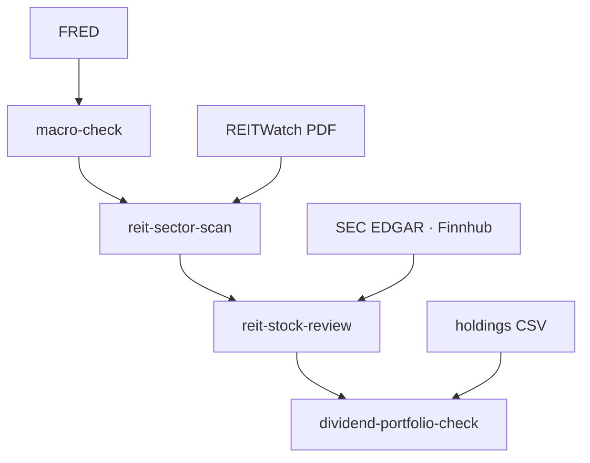

# 미국 REITs·배당주 분석 skill 묶음

상태: 구현 중 (2026-11-18)

사용자가 맡김(2026-11-18): slice 동의, 결과 확인, PR merge까지 agent가 이중 확인으로 대신한다.

## 문제

미국 REITs에 배당 투자를 하면서 매번 매크로 지표, 섹터 밸류에이션, 종목 공시를 손으로 찾아 맞춘다. 공개된 Agent Skill 중에는 REIT 지표(FFO, AFFO, implied cap rate, 만기 사다리, WALE)를 계산까지 해 주는 것이 없고, 매크로·섹터 저평가를 함께 보는 것도 없다. LLM에게 그냥 물으면 출처 없는 숫자가 섞이고, 같은 질문에 다른 숫자가 나온다.

## 지금 구조

- `~/invest-skills`는 빈 레포다(`skills/.gitkeep`만 있음). 규칙은 `AGENTS.md`에 있다.
  - `AGENTS.md:11`: 스크립트는 자기 skill 폴더 안의 것만 import한다. skill 하나만 설치해도 그 skill의 스크립트가 돌아야 한다.
  - `AGENTS.md:19-21`: 개인 투자 정보·secret을 레포에 두지 않는다. 매수·매도를 권하는 문장을 쓰지 않는다.
- skill은 `~/.claude/skills`, `~/.agents/skills`에 work-skills의 skill과 한 단계로 symlink된다. 이름이 겹치면 안 된다.

## 목표와 하지 않을 것

- 목표
  - 사용자가 말로 부탁하면 agent가 아래 여섯 가지를 해낸다: 매크로 점검, 저평가 섹터 찾기, 종목 하나 깊게 분석, 같은 섹터 종목 비교, 분기 실적 뒤 점검, 내 포트폴리오 점검.
  - 숫자는 script가 계산하고, 모든 값에 출처·기준일·상태가 붙는다. 같은 입력이면 같은 숫자가 나온다.
- 하지 않을 것
  - 매수·매도 추천, 목표가, 주문 계획. 결과는 판단 재료다.
  - 한국 상장 리츠(K-REITs). 지금은 미국만 다룬다. 지표 틀은 나중에 재사용할 수 있게 둔다.
  - 유료 데이터(Green Street P/NAV, CoStar, STR) 연동.
  - 실시간 시세, 자동 매매.

## 제약

- public MIT 레포. 개인 투자 정보(보유 종목, 관심 종목, 매매 기록), 받은 데이터(REITWatch는 Nareit 저작물), API key를 레포에 두지 않는다.
- Python 3 표준 라이브러리만 쓴다(이 Mac은 python3 3.9.6, requests·pandas 없음). 외부 도구는 `pdftotext` 하나다.
- SEC EDGAR는 User-Agent에 연락처를 요구하고 초당 10회까지다. 연락처는 환경 변수 `SEC_USER_AGENT`로만 받는다.
- Claude Code와 Codex가 같은 SKILL.md를 읽는다. 특정 agent에만 있는 도구는 "있으면 쓰고, 없으면"으로 쓴다.

## 끝났는지 확인하는 방법

- skill마다 `python3 <skill>/scripts/<이름>.py --check`가 network 없이 fixture로 돌아 exit 0이다.
- 실제 데이터로 한 번씩 돈다: `macro-check`가 FRED snapshot을 만들고, `reit-sector-scan`이 최신 REITWatch로 섹터 표를 만들고, `reit-stock-review`가 O(Realty Income) 2026Q3 FFO를 회사 발표값 1,041,026천 달러와 맞추고, `dividend-portfolio-check`가 가상 holdings 파일로 보고서를 낸다.
- diff에 개인 투자 정보·secret·받은 데이터 파일이 없다.

## 용어

- **snapshot**: 한 시점의 값을 담은 JSON 파일. 날짜·분기 이름으로 쌓고 덮어쓰지 않는다.
- **데이터 폴더**: `$INVEST_DATA_DIR`(기본 `~/invest-data`). 레포 밖에서 snapshot·보고서·holdings를 담는다.
- **status**: 값마다 붙는 상태. `reported`, `derived`, `estimated`, `stale`, `missing` 다섯 가지.
- **flag**: 지표 판정. `ok`, `watch`, `alert`, `review`. `review`는 데이터가 없어 판단 못 함이다.
- **REITWatch**: Nareit이 매달 내는 PDF. subsector와 종목별 가격, consensus FFO, P/FFO, 배당수익률이 있다.
- **웹 채우기**: script로 못 받는 값을 agent가 웹 검색으로 찾아 출처와 함께 적는 일.

## 동작

| # | 동작 | 증명 |
| --- | --- | --- |
| B1 | "금리·고용 요즘 어때", "매크로 점검해줘"라고 하면 `macro-check`가 FRED에서 금리·credit spread·물가·고용·경기·주택·건설 지표를 받아 snapshot과 보고서를 쓴다. 지표마다 최신값, 1·3·12개월 변화, YoY, 10년 percentile이 있다 | S1: `env -u FRED_API_KEY python3 skills/macro-check/scripts/macro.py fetch --sector office` exit 0, 28초, `~/invest-data/macro/snapshots/2026-11-18.json`에 FRED 31개 series가 모두 reported(stale 0). 지표마다 `derived`에 chg_1m·3m·12m, yoy_pct, pctile_10y(예: DGS10 5.12, +0.03/+0.44/+0.98, pctile 99.3195). 나머지 섹터 7개도 각각 받아 48개 series 전부 reported. snapshot으로 `~/invest-data/macro/reports/2026-11-18.md`(group 7절 + office·retail 섹터 절 + 데이터 구멍)를 썼다. `--check`가 손계산 값(USPBS YoY 1.2044, 가상 TESTM percentile 25.0, CPI 2025-10 빈 달이면 12개월 변화 null)과 맞음 |
| B2 | 섹터 이름을 주면 그 섹터의 수요·공급 지표(예: 오피스 ↔ professional and business services 고용, 오피스 건설 지출)를 함께 낸다 | S1: 같은 run의 `sectors.office` = USPBS, USINFO, USFIRE(수요), TLOFCONS(공급). 이어서 `fetch --sector retail`을 돌리자 같은 날 snapshot에 retail 6개가 더해지고 office와 웹 값이 남음(series 35개). `--check`의 "--sector office는 core + office" 통과 |
| B3 | `FRED_API_KEY`가 없어도 B1이 돈다 | S1: 위 run이 `FRED_API_KEY` 없이(`env -u`) `fred_access: fredgraph.csv`로 돌았다. DGS10 최신값 5.12(2026-11-16)가 https://fred.stlouisfed.org/series/DGS10 page의 "2026-11-16: 5.12"와 같음. custom User-Agent를 붙이면 fredgraph가 응답하지 않아 urllib 기본값을 쓴다 |
| B4 | FRED에 없는 값(ISM PMI, Fed funds 기대치)은 웹 채우기로 넣고 `source: web`과 URL을 단다. 못 찾으면 `missing` | S1: ISM 1차 자료 PDF(ismworld.org r4in202610pmi.pdf)의 "The Manufacturing PMI® registered 55.5 percent."를 `macro.py web ISM_MFG_PMI --value 55.5 --as-of 2026-10 --url ... --quote ...`로 넣어 `reported`, `source: web:<URL>`, `locator`=원문. CME FedWatch page는 60초 timeout이라 `--missing`으로 missing. `--quote` 없이 넣으면 exit 1로 거절. `--check`가 `--secondary`→estimated, 오래된 기준일→stale을 확인 |
| B5 | "어느 섹터가 싸", "저평가 섹터 찾아줘"라고 하면 `reit-sector-scan`이 REITWatch를 받아 subsector마다 median P/FFO·배당수익률의 자기 history percentile·z-score, 배당수익률−10년물 spread, 3·5년 상대 성과를 표로 낸다 | |
| B6 | 처음 돌 때 2015-01부터 분기말 달(3·6·9·12월)과 최근 12개월을 backfill한다. 파싱한 JSON만 남기고 PDF는 지운다 | |
| B7 | 섹터를 고르면 그 섹터 종목의 screening 표(P/FFO, 배당수익률, 시총, debt ratio)를 낸다 | |
| B8 | 구조적 하락 신호(수요 지표가 계속 나빠지고, 공급이 계속 늘어남)가 있는 섹터는 "싸 보이는 이유"를 함께 적는다 | |
| B9 | "O 분석해줘"라고 하면 `reit-stock-review` deep mode가 EDGAR에서 최신 실적 8-K Ex.99와 XBRL을 받고, agent가 값을 읽어 facts에 위치와 함께 적고, script가 지표를 계산해 보고서를 쓴다 | |
| B10 | deep 보고서에는 FFO→AFFO bridge, 배당 지속성(forward yield, AFFO payout, 배당 CAGR, 컷 이력), 재무(net debt/EBITDAre, coverage, 고정금리 비중, 만기 사다리), 운영(occupancy, WALE, 임차인 집중도, same-store NOI, 섹터별 지표), valuation(P/FFO·P/AFFO의 자기 history·peer·10년물 대비, implied cap rate), 다시 볼 조건, 데이터 구멍이 있다 | |
| B11 | Nareit 식으로 다시 계산한 FFO가 회사 발표값과 0.5% 넘게 다르면 exit 2이고 보고서 "데이터 구멍"에 올린다 | |
| B12 | "PLD, REXR, EGP 비교해줘"라고 하면 compare mode가 종목마다 facts를 만들고 같은 표에 놓는다. 다른 섹터를 섞으면 경고한다 | |
| B13 | "O 실적 나왔는데 봐줘"라고 하면 earnings mode가 새 분기 facts를 만들고 직전 분기 metrics와 diff해 바뀐 지표·flag를 보고한다 | |
| B14 | 일반 배당주(REIT가 아닌 종목, SIC 6798이 아님)는 FFO 대신 EPS·FCF payout, Chowder rule 경로를 탄다 | |
| B15 | 주가는 `FINNHUB_API_KEY`가 있으면 Finnhub에서, 없으면 웹 채우기로 받는다. 값마다 기준일이 있다 | |
| B16 | "내 포트폴리오 점검해줘"라고 하면 `dividend-portfolio-check`가 holdings CSV를 읽어 비중, 섹터 쏠림, 예상 연 배당과 월별 배당 일정, 종목별 flag, 금리 민감도 노출을 보고한다 | |
| B17 | 분석이 없거나 오래된 종목(새 실적 8-K가 나왔는데 metrics가 그 전 분기)은 `reit-stock-review`로 자동으로 다시 분석한다. 시작 전에 몇 종목인지 알린다 | |
| B18 | holdings 경로는 `INVEST_HOLDINGS_FILE` 또는 `$INVEST_DATA_DIR/holdings.csv`이고, 없으면 사용자에게 묻는다. 레포에는 가상 예시만 있다 | |
| B19 | 위 단계 skill의 snapshot이 없거나 오래됐으면, 그 skill이 설치돼 있으면 갱신하고 아니면 그 칸을 `missing`으로 두고 계속한다 | |
| B20 | 어떤 보고서에도 "사라", "팔아라", 목표가가 없다 | S1: SKILL.md "해석할 때"에 추천·목표가 금지를 적었다. 위 보고서에 `grep -E '사라|팔아|매수하|매도하|목표가|비중을 (늘|줄)|buy|sell'` 0건(머리의 "매수·매도 권유가 아니다" 고지만 있음). S3·S5 보고서에서 다시 확인한다 |

## 설계

skill 넷이 데이터 소스 하나씩을 맡는다. skill끼리는 데이터 폴더의 JSON 파일로만 주고받고, 읽는 방향은 한쪽이다.



### skill과 데이터 owner

| skill | 혼자 쓰는 데이터 (`$INVEST_DATA_DIR` 아래) | 읽기만 하는 데이터 |
| --- | --- | --- |
| `macro-check` | `macro/cache/`, `macro/snapshots/<날짜>.json`, `macro/reports/<날짜>.md` | 없음 |
| `reit-sector-scan` | `reitwatch/parsed/<YYYY-MM>.json`, `reitwatch/history.csv`, `sectors/reports/<날짜>.md` | macro snapshot |
| `reit-stock-review` | `tickers/<T>/filings/`, `tickers/<T>/facts/<분기>.json`, `tickers/<T>/metrics/<분기>.json`, `tickers/<T>/reports/<날짜>-<mode>.md`, `compare/<날짜>-<tickers>.md` | macro snapshot, REITWatch parsed |
| `dividend-portfolio-check` | `portfolio/snapshots/<날짜>.json`, `portfolio/reports/<날짜>.md` | holdings, 종목 metrics |

### scripts

공통 약속: Python 3 stdlib. 결과 JSON은 `--out` 파일(없으면 stdout), 사람이 볼 말은 stderr. exit 0 = 다 채움, 2 = 계산은 했지만 `missing`이나 check 실패가 있음, 1 = 입력·network 오류. 모든 script에 offline `--check`.

| 위치 | 명령 |
| --- | --- |
| `macro-check/scripts/macro.py` | `fetch [--group G] [--sector S] [--out P]`, `web ID (--value V --as-of D --url U --quote Q [--secondary] \| --missing 이유) [--snapshot P]`, `--check`. series 목록은 `assets/series.json` |
| `reit-sector-scan/scripts/reitwatch.py` | `fetch --month YYYY-MM [--backfill]`, `sectors [--macro-snapshot P]`, `peers --subsector S \| --ticker T`, `--check` |
| `reit-stock-review/scripts/edgar.py` | `resolve T`, `filings T`, `exhibits T --accession A`, `xbrl T --period P`, `dividends T` |
| `reit-stock-review/scripts/quote.py` | `price T...` |
| `reit-stock-review/scripts/reit_calc.py` | `metrics --facts F`, `diff --prev M1 --curr M2`, `compare --metrics M...`, `--check` |
| `dividend-portfolio-check/scripts/portfolio.py` | `check --holdings P`, `--check` |

### 값의 형식

```json
{"value": 1041026, "unit": "USD thousands", "status": "reported",
 "as_of": "2026-09-30", "source": "sec:8-K ex99.1", "locator": "FFO reconciliation table", "note": ""}
```

- `reported`: 원문 값. `source`·`locator` 필수.
- `derived`: reported 값으로 정해진 식 계산. 입력 중 가장 나쁜 status를 물려받는다.
- `estimated`: 가정이 든 값. 가정을 `note`에 쓴다.
- `stale`: 기준일이 허용 기간을 넘었다.
- `missing`: `value`는 null, `note`에 이유. 0이나 보간으로 채우지 않는다. 입력이 하나라도 missing이면 계산값도 missing이다.
- 웹 채우기 값은 `source: "web:<URL>"`이고 `locator`에 원문 문장을 그대로 둔다. 회사 IR·SEC·통계 기관 같은 1차 자료면 `reported`, 기사·블로그 같은 2차 자료면 `estimated`다.

## 결정

| # | 결정 | 답 | 정한 쪽 | 먼저 정할 것 | 이유와 버린 대안 | 상태 |
| --- | --- | --- | --- | --- | --- | --- |
| D1 | skill 나누기 | 데이터 owner 넷: macro-check, reit-sector-scan, reit-stock-review, dividend-portfolio-check | 사용자 | 없음 | 할 일마다 6개면 EDGAR 코드가 import 규칙 때문에 3~4벌 복사된다. 하나로 몰면 description이 여섯 요청을 담아 흐려진다 | 정해짐 |
| D2 | 만드는 순서 | ① macro-check → ② reit-sector-scan → ③ reit-stock-review → ④ dividend-portfolio-check, skill 하나에 PR 하나 | 사용자 | D1 | 데이터가 흐르는 순서대로 만들어 위 단계 snapshot을 실제로 읽으며 만든다 | 정해짐 |
| D3 | 데이터 폴더 | `$INVEST_DATA_DIR`, 기본 `~/invest-data` | 사용자 | 없음 | public 레포에 개인 정보·받은 데이터를 둘 수 없다 | 정해짐 |
| D4 | 주가 소스 | `FINNHUB_API_KEY`가 있으면 Finnhub `/quote`, 없으면 웹 채우기 | 사용자 + agent | 없음 | 무료 key가 없는 소스(Stooq)는 bot 확인 화면이 뜬다. Alpha Vantage 무료는 하루 25회 수준이라 compare·portfolio에 모자라다(2차 자료, 만들 때 확인) | 정해짐 |
| D5 | 오래된 종목 | portfolio 점검이 자동으로 다시 분석한다 | 사용자 | D1 | 한 번에 최신으로 맞춘다. token이 많이 들어 시작 전에 몇 종목인지 알린다 | 정해짐 |
| D6 | 숫자 계산 | script만 계산한다. agent는 공시에서 값을 읽어 위치와 함께 적고 해석한다 | agent | 없음 | 같은 입력이면 같은 숫자. FFO 표는 회사마다 모양이 달라 regex 파싱은 버렸다 | 정해짐 |
| D7 | 빈칸 | script로 못 받는 값은 웹 채우기. 출처 URL·원문 문장 없으면 missing | 사용자 | D6 | LLM 웹 검색이 대개 잘 찾지만 그럴듯한 틀린 숫자가 섞일 수 있어 출처와 상태로 가린다 | 정해짐 |
| D8 | FRED 접근 | `fredgraph.csv?id=<ID>`(key 없음)가 기본, `FRED_API_KEY`가 있으면 공식 API | agent | 없음 | key 없이 바로 쓰게 한다. 문서에 없는 endpoint라 끊길 수 있어 공식 API를 둘째로 둔다. 2026-11-18 DGS10으로 확인 | 정해짐 |
| D9 | REITWatch 값 | 종목 row로 subsector median을 다시 계산한다. PDF의 AVERAGE, FFO payout, Debt/EBITDA column은 쓰지 않는다 | agent | 없음 | AVERAGE는 outlier에 약하다(2018-12 Free Standing 평균 27.46, median 18.37). payout·Debt/EBITDA는 O 값이 여러 달 같아 멈춰 있다 | 정해짐 |
| D10 | REITWatch backfill | 2015-01부터 분기말 달 + 최근 12개월, PDF는 파싱 후 지운다 | agent | D3 | percentile에 history가 필요하다. 매달 다 받으면 PDF가 1GB 안팎이다 | 정해짐 |
| D11 | 기준값 | AFFO payout 85% watch·100% alert, 만기 한 해 집중 15% watch·20% alert. `reit-stock-review/assets/thresholds.json` 한 곳 | agent | 없음 | CaseMark·kanchi 기준을 가져왔다. 경험칙이라 보고서에 "경험칙"으로 적는다 | 정해짐 |
| D12 | 가져다 쓴 코드의 라이선스 | CaseMark(Apache-2.0)에서 가져온 절차가 든 파일에 원본·변경 고지를 단다. joellewis·kanchi(MIT)는 README에 출처를 적는다 | agent | 없음 | Apache-2.0 4(b)·(c) | 정해짐 |
| D13 | macro series 고르기 | `assets/series.json` 항목에 `core`(기본 점검에 넣나), `unit`, `source`(`fred`·`web`), 필요하면 `note`를 더 둔다. `fetch`는 `core` 항목, `--sector S`면 S 항목을 더하고, `--group G`면 그 group만 남긴다 | agent | D8 | 주택담보 금리처럼 기본 점검이면서 섹터 지표인 series가 있어 `sectors`만으로는 기본 점검을 가를 수 없다. fredgraph CSV에는 단위가 없어 목록에 둔다 | 정해짐 |
| D14 | 같은 날 다시 받기 | 같은 날 snapshot 파일이 있으면 새로 받은 series만 바꾸고 나머지(다른 섹터, 웹 채우기 값)는 남긴다 | agent | D3 | 오피스를 받고 리테일을 받으면 하루 snapshot 하나에 둘 다 있어야 다른 skill이 최신 파일 하나만 읽는다 | 정해짐 |
| D15 | 웹 채우기 값 넣기 | `macro.py web` 명령이 snapshot의 `web` 항목에 넣는다. URL과 원문 문장이 없으면 거절하고, `--secondary`면 `estimated`, 아니면 `reported`다 | agent | D7 | agent가 JSON을 손으로 고치면 출처 없는 값이 들어갈 수 있다. script가 D7 규칙을 막는다 | 정해짐 |
| D16 | macro 계산 규칙 | 변화: 일·주 자료는 목표일 이전 7일 안의 마지막 관측, 월·분기 자료는 같은 날짜 관측과 뺀다(없으면 null). 분기 자료는 1개월 변화 없음. YoY는 단위가 Percent가 아닐 때만. 10년 percentile: 최신일 10년 전 초과~최신일 관측 중 최신값 이하 비율(%), history가 10년보다 짧으면 null. stale은 관측일(기간 시작일)부터 오늘까지 일수가 `max_lag_days`를 넘을 때. exit 2는 FRED series의 missing만 센다(웹 채우기 전 항목은 세지 않음) | agent | D6 | 2025-10 CPI처럼 빠진 달을 옆 달로 메우면 틀린 변화가 나온다. 금리의 YoY(%)는 뜻이 없어 12개월 변화(%p)로 본다 | 정해짐 |

## test할 seam

- 각 script CLI의 `--check`: fixture 입력 → 기대 JSON. 계산식과 status 전파를 잡는다. network·파싱 변화는 놓친다.
- 실제 데이터 한 번 돌리기(끝났는지 확인하는 방법): 소스 형식 변화를 잡는다. 결과가 매번 달라 자동 비교는 안 한다.

## 버린 후보

- **할 일마다 skill 6개**: 이름은 분명하다. 버린 이유: EDGAR 수집·계산 코드가 여러 벌 복사된다.
- **데이터 엔진 skill 하나 + 절차 skill 셋**: 코드는 한 벌이다. 버린 이유: 절차 skill 하나만 설치하면 돌지 않아 `AGENTS.md:11`을 어긴다.
- **skill 하나**: 설치가 가장 쉽다. 버린 이유: description 하나에 여섯 요청과 서로 다른 주기를 담아야 한다.

## slice

| # | 만드는 것 | 채우는 동작 | 먼저 끝나야 하는 slice | 증명 방법 | 상태 |
| --- | --- | --- | --- | --- | --- |
| S1 | `macro-check`: series 목록, key 없는 FRED 수집·cache, snapshot(변화·YoY·percentile), 섹터 지표, 웹 채우기 절차, `--check` | B1, B2, B3, B4, B20 | 없음 | `FRED_API_KEY` 없이 `macro.py fetch --sector office`가 exit 0~2로 snapshot을 쓰고, DGS10 최신값이 FRED 웹 값과 같다. `--check` exit 0 | 끝: key 없이 `fetch --sector office` exit 0, FRED 31개 reported, DGS10 5.12(2026-11-16)가 FRED page와 같음. `--check` exit 0(손계산 값, 로직을 하나씩 일부러 깨는 mutation 11개가 모두 FAIL로 잡힘). 보고서 작성, ISM 웹 채우기 reported, FedWatch missing |
| S2 | `reit-sector-scan`: REITWatch 받기·파싱·backfill, subsector median·percentile·spread·상대 성과 표, peers, 구조적 하락 메모 | B5, B6, B7, B8, B19 | S1 | 최신 REITWatch로 섹터 표가 나오고 Free Standing median이 PDF row로 손계산한 값과 같다. macro snapshot을 지우면 spread 칸이 missing으로 나온다 | 대기 |
| S3 | `reit-stock-review` deep: EDGAR resolve·filings·exhibits·xbrl, Finnhub·웹 시세, facts 형식, `reit_calc.py metrics`, 보고서 | B9, B10, B11, B15, B19, B20 | S2 | O 2026Q3 deep 보고서가 나오고 FFO 재계산이 1,041,026과 같다. FFO 입력 하나를 바꾸면 exit 2와 데이터 구멍이 나온다 | 대기 |
| S4 | `reit-stock-review` compare·earnings·일반 배당주 경로 | B12, B13, B14 | S3 | PLD·REXR·EGP compare 표, O 2026Q2→Q3 earnings diff, 일반 배당주 1종목(가상 아님, 예: JNJ) payout 경로 | 대기 |
| S5 | `dividend-portfolio-check`: holdings 형식·가상 예시, 비중·섹터·배당 일정·금리 노출, 오래된 종목 자동 재분석 | B16, B17, B18, B19, B20 | S4 | 가상 holdings 3종목으로 보고서가 나오고, metrics가 없는 종목이 자동으로 분석된 뒤 표에 들어간다 | 대기 |
